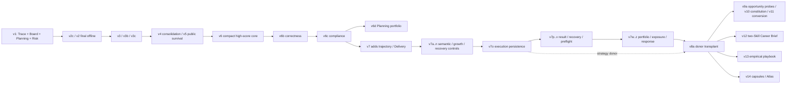

# S10-17｜Candidate Family Portfolio

Status: COMPLETE / IN_FLIGHT_EVIDENCE。唯一路线建议：`V6D_FALLBACK + NO_MORE_ARCHITECTURE_EXPLORATION`。
Fallback：`PROMOTE_V6D_TO_PRIMARY_FALLBACK`。Challenger：`NO_JUSTIFIED_CHALLENGER`。
下一具体任务：**S10-18 第三次 exact v6d replication**，另行批准一局完整游戏；本任务不授权它。

## 身份、范围和证据层级

Branch `codex/s10-17-candidate-family-portfolio`；依赖基线 `ce95a01297424d930a64b2a63c36b7e6e215090e`（S10-16）。当前 runtime 仍是 exact v6d `e7e8ab44dd85a29135eb089ef29de8fed298f4a4`。只新增三份战略评审资产和 branch-local CURRENT_STATE。Candidate、Skills、manifest、Runner、依赖、Provider、retry、正式 fallback freeze 均不改。install/service/provider/game=0。

FACT=有 Git/接受对局记录支持；MEASURED=本次静态源码计数；INFERENCE=对观察样本的解释；RECOMMENDATION=交 Main 的路线建议。这里不把建议写入 current_candidate，也不宣布 v6d 已正式冻结或已经可上传。main 的 v8a freeze `6a4037fdf2b75c105cfe0b40b93ea68d3dd0a6f3` 是既有事实，与推荐切换有别。

数据入口：[lineage matrix](S10-17_LINEAGE_MATRIX.json)。54 个保留身份节点；58 个 score/partial/pre-game记录；其中25个已绑定 Flash/official Runner 自然终局样本。根 RUN_HISTORY 是历史 v6c 分支快照，不能直接当现代全量索引；本次从 S09 pinned Git 和 S10 接受提交补齐。

审查集合是正式 Candidate benchmark / screening attempts，并保留 baseline、Codex发现局和 formal-scaffold异执行器对照。S07 transport/affordability机械探针不是完整策略游戏：`c41a1b7:docs/project/runs/s07-07-mechanical-probe-batch.json`、s07-09/10/11/12 batch只作为接口证据，不加入 family成绩。S09 RUN09 是静态工作，不虚构游戏。SCORE-01、S06 Run #1 的 Candidate身份在canonical记录中仍 UNKNOWN；不从53.83成绩倒推v2/v3身份。其余未绑定发现局明确归 Codex/direct MCP，不冒称v6c Flash样本。这个历史小缺口不改变 v1/v6/v6d/v8a 的关键身份或路线比较。

来源（完整 commit:path 在 JSON每个run中）：

- `c41a1b7210a02603aa19cc2bab19922a80b6cd77:docs/project/RUN_HISTORY.md`、research/S09_RUN_SUMMARY.json、S09_CLOSEOUT.md，以及各canonical run记录；本次仅取公开结果、身份、静态结构、审计结论，不取隐藏状态/公式。
- v1 exactsource `7a055dea76580117ca74cddb49bb04efcf605eb1`；S04-04 frozen manifest（`c4dbe0e:experiments/S04-04-high-score-confirmation/candidate_manifest.json`）证明两局同source。v1 raw不补造，行为细节只到Tier-B summary粒度。
- v6接受source `1114a04b75548cf52f030d123564e527060fc061`；v7o `b2e7ea6441da9c314d8a0ffbf29b9d5800ced10d`；v8a最终freeze `6a4037f...`；source字段为确切Git对象，不重新安装历史版本。
- S10-03 `673caa9`；S10-06 `7bd7c92`；S10-09 `4f54967`；S10-10 `69f26a4`；S10-12 `5eb108b55a9f252d4fd6ff4561120d353f9d124b`；S10-14 `ce92da5cda9c5da2e2b4f2140e35880e8ea77a6a`。
- S10-13 `16289dd2ca35f97396626fdd61461538f2efe4f0`；S10-15 `0a7e9349d73b443efa91721fab01067f969d1a1b`；S10-16当前base。复用已接受 forensic，不重做720-transition数据集、不重读shared DB、不解除raw FORENSIC_HOLD。

## 血缘和真正的 DNA

版本号不是策略族。A为早期four-Skill growth/planning祖先；B为v6三Skill core；C为加Delivery的v7/v8 donor-shell族；D为之后架构/语义控制实验；E只作v4/v5 consolidation bridge。单一submitter贯穿正式Candidates；没有可部署Team候选。

v6→v6b：correctness-only（DecisionClosed、single integer Energy、compression epoch recovery）。v6b→v6c：surgical compliance清理，不重做策略。v6c→v6d：Planning-only report/intensive资源比较、Network一级资产、Review后组合重查；Board/Risk/kernel保持。v6d并不继承v7/Delivery。

v7早期已经加入promotion-first、生存floor、semantic Story priors、trajectory/Delivery；v7g缩短合约，v7i加pre-review result realization，v7j–n加closure/evidence/recovery并扩大协议。v7o融合growth与whole-game persistence；v7t修复中文恢复语义，v7v仅修preflight排序。v7w不是全新donor：在v7v shell里恢复高分策略；v7x重新授权stabilization；v7y Story exposure；v7z scope-local response。v8a以v7z为runtime parent、**v7o为strategy donor**，且明确cross-check v6 common core。它已删portfolio/coverage/exposure overlay、保留ownership/broad compounding/result realization和最低必要保护。S09-10移植报告是判定重名hybrid的关键来源。

v9a改变opportunity probes；v10c及其子版本已经试persistent/compaction-agnostic kernel与certificate；v11/11b试result conversion/public-risk continuity/early feasibility。v12以v8a为parent做两Skill统一Brief/material checkpoint重构。v13以v8a为parent替换Planning empirical playbook；v14同parent做三Skill+6reference cards、fresh capsule、选择性披露。v12原任务名Family A不是这里的v1 DNA Family A。

以下紧凑矩阵的source/status是源码记录，不把static status误当运行有效性。精确source、hash、control_delta、每run出处和terminal mode都在JSON。早期v2c→v2、v3→v3b→v3c有独立manifest；没有被可靠绑定的live不补给它们。

| Candidate | Parent | Skills | Major delta | Recorded attempts | Natural Flash range | 48m/n | Evidence status |
|---|---|---|---|---|---|---|---|
| v3c | v3b-final-policy | 4 | NONE | none found | N/A | N/A | STATIC_ONLY_NO_LIVE_RECORD_FOUND |
| v4 | v3c-zh-aligned-policy | 3 | RUNTIME_POLICY_CONSOLIDATION | v4 #1 | 25.84–25.84 | 0/1 | NATURAL_GAMEPLAY_RECORDED |
| v5 | v4-lean-runtime-policy | 3 | EVIDENCE_DRIVEN_SURVIVAL_PHASE_POLICY | none found | N/A | N/A | STATIC_ONLY_NO_LIVE_RECORD_FOUND |
| v6 | v5-evidence-driven-phase-policy | 3 | AUDITABLE_CANDIDATE_FIRST_CONTROL_LOOP | v6 #1 | 75.29–75.29 | 1/1 | NATURAL_GAMEPLAY_RECORDED |
| v6b | v6-auditable-control-loop | 3 | RUNTIME_CORRECTNESS_ONLY_NO_STRATEGY_REDIRECT | none found | N/A | N/A | STATIC_ONLY_NO_LIVE_RECORD_FOUND |
| v6c | v6b-runtime-correctness | 3 | COMPLIANCE_CLEANUP_ONLY_NO_STRATEGY_REDIRECT | S10-10/v6c,S07-19 Luna scaffold,S07-20 scaffold,S07-21 strong host scaffold | 64.26–64.26 | 1/1 | NATURAL_GAMEPLAY_RECORDED |
| v7 | v6c-compliance-cleanup | 4 | LONG_HORIZON_PROGRESSION_AND_DELIVERY_ARCHITECTURE | none found | N/A | N/A | STATIC_ONLY_NO_LIVE_RECORD_FOUND |
| v7a | v7-global-trajectory-delivery | 4 | PROMOTION_FRONTIER_LONG_HORIZON_OPTIMIZATION | none found | N/A | N/A | STATIC_ONLY_NO_LIVE_RECORD_FOUND |
| v7b | v7a-promotion-frontier | 4 | EVENT_AGNOSTIC_STORY_SEMANTIC_PRIORS | none found | N/A | N/A | STATIC_ONLY_NO_LIVE_RECORD_FOUND |
| v7c | v7b-semantic-generalization | 4 | HIERARCHICAL_DECISION_POLICY_AND_PROGRESSIVE_DISCLOSURE | none found | N/A | N/A | STATIC_ONLY_NO_LIVE_RECORD_FOUND |
| v7d | v7c-global-decision-policy | 4 | ACTIVE_REVIEW_PLAN_WITH_EVIDENCE_GATED_REVISION | v7d | 17.02–17.02 | 0/1 | NATURAL_GAMEPLAY_RECORDED |
| v7e | v7d-strategic-continuity | 4 | FORMAL_REVIEW_ANCHORED_LEAN_REVIEW_CONTROLLER | none found | N/A | N/A | STATIC_ONLY_NO_LIVE_RECORD_FOUND |
| v7f | v7e-lean-review-controller | 4 | PROMOTION_FIRST_WITH_SURVIVAL_FLOOR | none found | N/A | N/A | STATIC_ONLY_NO_LIVE_RECORD_FOUND |
| v7g | v7f-promotion-first-survival-floor | 4 | PROFESSIONAL_SKILL_CONTRACT_REFACTOR | v7g pregame,v7g | 54.52–54.52 | 1/1 | NATURAL_GAMEPLAY_RECORDED |
| v7h | v7g-compact-skill-contracts | 4 | PRESERVE_V7G_STRATEGY | none found | N/A | N/A | STATIC_ONLY_NO_LIVE_RECORD_FOUND |
| v7i | v7h-evidence-recovery-hardening | 4 | PRE_FIRST_REVIEW_RESULT_REALIZATION_PRIOR | v7i pregame,v7i replacement | 64.0–64.0 | 1/1 | NATURAL_GAMEPLAY_RECORDED |
| v7j | v7i-pre-review-result-realization-probe | 4 | DECISION_CLOSURE_HARDENING_ONLY | none found | N/A | N/A | STATIC_ONLY_NO_LIVE_RECORD_FOUND |
| v7k | v7j-decision-closure-hardening | 4 | OBSERVABILITY_ONLY | none found | N/A | N/A | STATIC_ONLY_NO_LIVE_RECORD_FOUND |
| v7l | v7k-delivery-observability-hardening | 4 | PRE_GAME_CONTRACT_CONSISTENCY_ONLY | none found | N/A | N/A | STATIC_ONLY_NO_LIVE_RECORD_FOUND |
| v7m | v7l-pre-game-contract-hardening | 4 | FINAL_PRE_GAME_CORRECTNESS_AND_AUDIT_ONLY | v7m | N/A | N/A | PARTIAL_OR_PRE_GAME_ONLY |
| v7n | v7m-final-r-recovery-audit-hardening | 4 | S07_47_EVIDENCE_BACKED_CORRECTNESS_PATCH_ONLY | v7n pregame,v7n replacement | N/A | N/A | PARTIAL_OR_PRE_GAME_ONLY |
| v7o | v7n-public-state-delivery-constraint-hardening | 4 | MODE_BINDING_CORRECTNESS_CLARIFICATION_ONLY | v7o | 71.83–71.83 | 1/1 | NATURAL_GAMEPLAY_RECORDED |
| v7p | v7o-execution-persistence-convergence | 4 | REVIEW_GAP_DIRECTNESS_AND_COMPRESSION_RESILIENT_KERNEL | none found | N/A | N/A | STATIC_ONLY_NO_LIVE_RECORD_FOUND |
| v7q | v7p-score-gap-convergence | 4 | CHECKPOINT_AWARE_MARGINAL_PROGRESSION | v7q | 26.8–26.8 | 0/1 | NATURAL_GAMEPLAY_RECORDED |
| v7r | v7q-checkpoint-marginal-progression | 4 | EARLY_PROMOTION_ESCAPE_AND_PROGRESS_RESPONSE | none found | N/A | N/A | STATIC_ONLY_NO_LIVE_RECORD_FOUND |
| v7s | v7r-early-promotion-rescue | 4 | ZH_ALIGNED_FAILURE_RECOVERY_AND_SKILL_COORDINATION | none found | N/A | N/A | STATIC_ONLY_NO_LIVE_RECORD_FOUND |
| v7t | v7s-zh-recovery-controller | 4 | EXECUTION_CONTRACT_AMBIGUITY_REPAIR_ONLY | v7t | 65.71–65.71 | 1/1 | NATURAL_GAMEPLAY_RECORDED |
| v7u | v7t-execution-semantic-repair | 4 | RUNTIME_ADHERENCE_PROTOCOL_ONLY | none found | N/A | N/A | STATIC_ONLY_NO_LIVE_RECORD_FOUND |
| v7v | v7u-runtime-adherence-protocol | 4 | RUNTIME_GATE_ORDERING_CORRECTION_ONLY | v7v | 58.97–58.97 | 1/1 | NATURAL_GAMEPLAY_RECORDED |
| v7w | v7v-preflight-ordering-repair | 4 | STABILITY_CONSTRAINED_PROMOTION_COMPOUNDING | S09 RUN01/v7w | 30.31–30.31 | 0/1 | NATURAL_GAMEPLAY_RECORDED |
| v7x | v7w-high-score-core-recovery | 4 | FRESH_BINDING_BASIS_REQUIRED_FOR_EACH_STABILIZATION_DECISION | S09 RUN02/v7x | 19.82–19.82 | 0/1 | NATURAL_GAMEPLAY_RECORDED |
| v7y | v7x-fresh-binding-reauthorization | 4 | M5_STORY_EXPOSURE_GUARD_AS_BOUNDED_A_MODE_RANKING_PRIOR | S09 RUN03/v7y,S09 RUN03R/v7y | N/A | N/A | PARTIAL_OR_PRE_GAME_ONLY |
| v7z | v7y-story-exposure-guard | 4 | LOCAL_RESPONSE_DOES_NOT_IMPLY_GLOBAL_CAP | S09 RUN04/v7z,S09 RUN05/v7z | N/A | N/A | PARTIAL_OR_PRE_GAME_ONLY |
| v8a | v7z-world-model-correction | 4 | CURRENT_RUNTIME_SHELL_PLUS_DIRECT_V7O_STRATEGY_CORE | S09 RUN06/v8a,S09 RUN07/v8a,S09 RUN08/v8a | 59.0–72.65 | 2/2 | NATURAL_GAMEPLAY_RECORDED |
| v9a | v8a-v7o-donor-core-transplant | 4 | ADAPTIVE_OPPORTUNITY_CAPTURE_WITH_BOUNDED_UNTESTED_PROBE | S09 RUN10/v9a | 68.4–68.4 | 1/1 | NATURAL_GAMEPLAY_RECORDED |
| v10a | v9a-adaptive-opportunity-capture | 4 | POLICY_CONSTITUTION_AND_SEMANTIC_QUARTERLY_CONTROL | none found | N/A | N/A | STATIC_ONLY_NO_LIVE_RECORD_FOUND |
| v10b | v10a-policy-constitution | 4 | ANTI_UNSUPPORTED_SATURATION_WORLD_MODEL_GUARD | S09 RUN11/v10b | N/A | N/A | PARTIAL_OR_PRE_GAME_ONLY |
| v10c | v10b-policy-constitution-anti-saturation | 4 | NONE | S09 RUN12/v10c | N/A | N/A | PARTIAL_OR_PRE_GAME_ONLY |
| v10d | v10c-compaction-agnostic-kernel | 4 | NONE | S09 RUN13/v10d | N/A | N/A | PARTIAL_OR_PRE_GAME_ONLY |
| v10e | v10d-anchored-five-marker-preflight | 4 | NONE | S09 RUN14/v10e | N/A | N/A | PARTIAL_OR_PRE_GAME_ONLY |
| v10f | v10e-explicit-basis-preflight | 4 | NONE | S09 RUN15/v10f,S09 RUN16/v10f | N/A | N/A | PARTIAL_OR_PRE_GAME_ONLY |
| v10g | v10f-cap-scope-correction | 4 | NONE | S09 RUN17/v10g | 24.47–24.47 | 0/1 | NATURAL_GAMEPLAY_RECORDED |
| v10h | v10g-official-runtime-evidence-boundary | 4 | A_MODE_DYNAMIC_SURVIVAL_MARGIN | S09 RUN18/v10h,S09 RUN19/v10h | 38.08–38.08 | 0/1 | NATURAL_GAMEPLAY_RECORDED |
| v11 | v10h-dynamic-survival-margin | 4 | RESULT_CONVERSION_AND_PUBLIC_RISK_PERSISTENCE | S09 RUN20/v11 | 60.6–60.6 | 1/1 | NATURAL_GAMEPLAY_RECORDED |
| v11b | v11-result-conversion-risk-persistence | 4 | PRE_FIRST_REVIEW_RESULT_FEASIBILITY_COMPARISON | S09 RUN21/v11b | N/A | N/A | PARTIAL_OR_PRE_GAME_ONLY |
| v12 | v8a-v7o-donor-core-transplant | 2 | LEAN_SINGLE_AGENT_CAREER_BRIEF_CHECKPOINT_REVIEW | S10-03/v12 | 23.48–23.48 | 0/1 | NATURAL_GAMEPLAY_RECORDED |
| v13 | v8a-v7o-donor-core-transplant | 4 | COMPACT_EMPIRICAL_PROMOTION_FIRST_PLANNING_ONLY | S10-06/v13 | 34.01–34.01 | 0/1 | NATURAL_GAMEPLAY_RECORDED |
| v14 | v8a-v7o-donor-core-transplant | 3 | EXPERIENCE_DISTILLED_PROCEDURES_SELECTIVE_DISCLOSURE_FRESH_CAPSULE_GROUNDED_LOOKAHEAD | S10-09/v14 | 16.1–16.1 | 0/1 | NATURAL_GAMEPLAY_RECORDED |
| v6d | v6c-compliance-cleanup | 3 | PLANNING_ONLY_BROAD_PROMOTION_PORTFOLIO | S10-12/v6d Run01,S10-14/v6d Run02 | 65.35–71.67 | 2/2 | NATURAL_GAMEPLAY_RECORDED |
| v1 | pre-v1 Board/Risk/action-trace integration | 4 | ADD_BOUNDED_ROLLING_PLANNING_TO_FOUR_SKILL_INTEGRATION | v1 #1,v1 #2 | 35.31–76.04 | 1/2 | NATURAL_GAMEPLAY_RECORDED |
| v2 | v2c-integrated-planning | 4 | CONTEXT_RECOVERY_AND_OBJECTIVE_REBUILD | none found | N/A | N/A | STATIC_ONLY_NO_LIVE_RECORD_FOUND |
| v3 | v2-final-offline | 4 | ADAPTIVE_CONTROL_PUBLIC_PROGRESS_STALL_RISK | none found | N/A | N/A | STATIC_ONLY_NO_LIVE_RECORD_FOUND |
| v2c | v1-four-skill (strategy ancestry; metadata parent null) | 4 | MATERIAL_OUTCOME_REPRIORITIZATION_AND_LOCAL_RESPONSE_COST_COMPARISON | none found | N/A | N/A | STATIC_ONLY_NO_LIVE_RECORD_FOUND |
| v3b | v3-adaptive-controller-static | 4 | FINAL_POLICY_TIGHTENING | none found | N/A | N/A | STATIC_ONLY_NO_LIVE_RECORD_FOUND |

## Family portfolio

| Family | Natural Flash samples | Observed best / worst | Observed 48m | 复杂度/有效性 | 主要局限 |
|---|---|---|---|---|---|
| A: v1 + offline v2/v3 | 2 | 76.04 / 35.31 | 1/2 | 4 Skills；v1完整refresh未证明，旧风险高 | v1同source spread40.73；trust terminal；后代static不能借用高分 |
| E: v4/v5 bridge | 1 | 25.84 / 25.84 | 0/1 | 3 Skills；v4较短；v5没有绑定live | M6 Health attrition；简化本身不是安全保证 |
| B: v6/b/c/d | 4 | 75.29 / 64.26 | 4/4（跨不同Candidate） | 3 Skills；source/package可部署，adherence未全通过 | v6仅1sample；v6b无live；v6d drift与risk spread |
| C: v7/v8 | 11 | 72.65 / 17.02 | 7/11（异质pool） | 4 Skills含Delivery；较多控制状态；v8a已有正式freeze | 早期淘汰、技术截断、无75；v8a exact spread13.65 |
| D: v9..14 | 7 | 68.40 / 16.10 | 2/7（异质pool） | 2–4 Skills；kernel/Brief/Atlas/rulebook不同实验 | 多natural负样本；大量审计censor无finalscore；Team不可部署 |

异质pool只是清点，不是family真实survival率。以exact同bytes作repeatability比较：v1=1/2、v8a=2/2、v6d=2/2自然48m；v6/v7o只有1/1，不能宣称repeatable。其他Candidate的单次best=worst只是一个观察值。

## v1 / v6 / v6d / v8a 的实用比较

| Metric | v1 | v6 | v6d | v8a |
|---|---|---|---|---|
| Exact自然samples | 2 | 1 | 2 | 2 |
| Range | 35.31–76.04 | 75.29 only | 65.35–71.67 | 59.00–72.65 |
| Observed spread | 40.73 | N/A | 6.32 | 13.65 |
| Descriptive mean / median | 55.675 / 55.675 | 75.29 / N/A | 68.51 / 68.51 | 65.825 / 65.825 |
| 48m | 1/2 | 1/1 | 2/2 | 2/2 |
| Final Level | L6 / L4 | L6 | L5 / L5 | L5 / L4 |
| 75+ sample | 1 | 1 | 0 | 0 |
| Policy stability | trust survival failure；full刷新不明 | 单sample，不可估 | Energy19/5/0 vs10/6/7(report/N/intensive)；明显drift | 早期promotion与成长盆地差异；不证明同政策稳定 |
| Submission/static | 历史合法架构；旧provenance/recovery限制 | 75.29是有效游戏；旧control/compliance不能直接当final | S10-11静态PASS，3Skill包、两局byteidentity PASS；未finalfreeze | canonical offline4Skill包PASS，FINAL_FROZEN_FOR_SUBMISSION |
| Runtime | Board完整refresh未证明 | 1次multi-select被拒；no reread；CTRL ambiguity | freshobserve202/202、198/198；integer/affordability/session PASS；closure/recovery/clock FAIL | freshobserve203/203、205/205；runtime_validated=false；Delivery parser界面争议，compressionUNKNOWN |
| Evidence confidence | Tier-B高分摘要+两局canonical，不能补raw细节 | canonical+接受public forensics；只1live | 两局hold+S10-13/15/16，行为证据最充分 | 两局canonical+public transitions；scoped LLM recovery不完整 |

这些均值/median是描述值，不是expected score或置信估计；两点median和mean相同没有额外意义。Survival robustness优先，其次competitive score，再次75+ reachability；不采用隐藏评分权重。v1 trust terminal使它不适合直接fallback；v6高分唯一sample，且v6b/v6c已试correctness后代；不能仅凭75.29回退旧风险/控制身份。v7o没有重复样本，在已有v8a/v6d两局对照下不是更稳的fallback证据。

**RECOMMENDATION：PROMOTE_V6D_TO_PRIMARY_FALLBACK。** v6d最低观察值比v8a高6.35；最高值低0.98；观察spread少7.33；两者完整自然局均2/2。v6d3Skills及11803字符full-body proxy比v8a4Skills/22866更小；当前来源清晰，不须增加架构。优势是当前样本中较好的failure floor与审计可解释性，不是显著优越或稳定75证明。

Validity硬边界：两者都已有合法bundle、自然完整游戏、single submitter和fresh-observe证据；均**没有完美authored-rule runtime validity**。v6d Run02两次错误route均在mutation前失败并恢复，不作unknown mutation；这与DecisionClosed/compression failure分别报告。v8a没有更强的压缩恢复证明，因此不把现存v8a freeze误称完美执行。若Main要求“所有作者控制协议必须PASS”才允许submission，则目前两者均不满足，需独立submission-hardening审查，不能用本战略报告授予豁免。

本次推荐fallback family/source选择，**不实施official冻结切换，不转移v6/v8a验证flags给v6d**。正式上传兼容性仍需Final Submission Contract的独立hardening/freezing/package审计；不为了报告结果调用validator或安装。v8a现有freeze保持作为历史可恢复交付身份，不再作为新的路线推荐并列fallback。

## 所有已绑定的75+证据

| Run | Candidate / source | Result | Main / Energy / risk / control |
|---|---|---|---|
| S04-03 v1 #1 | v1 / 7a055de | 76.04 / 48m / A / L6 | key project16/16；report25/Health11/Network6/cleanup3（accepted summary）；4Skills，早期Planning有限，trust-safe终局但replication淘汰 |
| S06-24 v6 #1 | v6 / 1114a04 | 75.29 / 48m / A / L6 | key project14/16+avoidance2；report15/Health10/Network8/intensive5/cleanup2/psych1；3Skills；runtime adherence FAIL |

在已绑定canonical Candidate benchmark和旁列Codex/scaffold终局中，只有这两局≥75；没有第三个被遗漏的正式≥75来源。机械/技术partial不猜finalscore。共同FACT：两局到L6、五次晋升M6/12/18/36/48、strong key-project、report/Health/Network多路线、Skill约139/142，不依赖大量Energy Skill farming。普通Story保留成长自由、以material danger而非轻微成本保护是common authored原则，但v7o/v8a也已继承，不是独有机制。v1 Risk10分和replica trust terminal并存；v6高分也有public warning/repair，不支持放弃风险保护。

与65–72局：v6d/v7o/v8a多停L5；v6d两局同为四晋升且时点不同。Run01风险组件10、Run02为4，6.32总分差主要伴随公开risk组件−6，不能把分差全部归到Portfolio或Skill。S10-13发现相近M18公开state可有不同promotion，Story Skill gain和late-result maturity都有反例；S10-16同choice+不同warning path，无安全risk patch。

INFERENCE：早期高分族提供高ceiling参考，但“只有这两局到75”不证明later架构不能75。共同Main/portfolio原则已被后代试过，不能把一个更多Skill/Report动作写成晋升公式。

## Complexity / performance：静态实测

| Candidate | Source | Skills | Manifest instruction chars | Skill chars | Instruction+Skills proxy | Reference files | Observed range |
|---|---|---|---|---|---|---|---|
| v1 | 7a055de | 4 | UNKNOWN | 15782 | UNKNOWN | 0 | 35.31–76.04 |
| v6 | 1114a04 | 3 | 943 | 9545 | 10488 | 0 | 75.29–75.29 |
| v6b | 8b6696a | 3 | 1049 | 9665 | 10714 | 0 | None–None |
| v6c | e5363c9 | 3 | 1049 | 9339 | 10388 | 0 | 64.26–64.26 |
| v6d | e7e8ab4 | 3 | 1049 | 10754 | 11803 | 0 | 65.35–71.67 |
| v7o | b2e7ea6 | 4 | 4273 | 26351 | 30624 | 0 | 71.83–71.83 |
| v7t | e4ec829 | 4 | 3570 | 14936 | 18506 | 0 | 65.71–65.71 |
| v7v | fd30db2 | 4 | 5122 | 16261 | 21383 | 0 | 58.97–58.97 |
| v8a | 6a4037f | 4 | 4373 | 18493 | 22866 | 0 | 59.0–72.65 |
| v9a | 1cc20d7 | 4 | 4373 | 19222 | 23595 | 0 | 68.4–68.4 |
| v12 | e6ddcda | 2 | 2038 | 8112 | 10150 | 0 | 23.48–23.48 |
| v13 | eed75f5 | 4 | 4549 | 14559 | 19108 | 0 | 34.01–34.01 |
| v14 | 59a8951 | 3 | 1211 | 4703 | 5914 | 6 | 16.1–16.1 |

MEASURED口径：Git canonical LF Unicode chars，含frontmatter、空行和末尾newline；manifest只数解析instruction，不数JSONmetadata；active SKILL.md之和，reference文件单列。v14六reference正文按需加载，不把全Atlas误当startup；实际startup loaded bytes/context常驻性仍由run证据决定，proxy不等于attention/token。v1/v2旧canonical manifest instruction未在该source可靠建立，UNKNOWN不记0。v7o/v6/v8a使用接受/运行/冻结版本，其他节点优先记录first implementation identity，不把draft计数混作接受版；各run的exactpackage以run记录为准。

“高分者在结构上更简单”的支持是**局部而非通则**：v6总10488比v7o30624/v8a22866明显小，且少一个Delivery Skill；v6d11803略大于v6，却比v1单Skill之和15782更短，仍未75。最短v4(5700)/v14(5914)和v12(10150)自然失败。v13叫empirical large rulebook也不意味着本次字符数最大：总19108仍小于v8a。因此不能声称字数或Skill数因果决定分数，不能以“再短一点”制造新路线。

## Runtime-control burden

| Mechanism | v1 | v6 | v6d | Judgment |
|---|---|---|---|---|
| Same-session / action→fresh observe | 完整刷新未证明 | 202 successful mutations→observe | 两局全action→observe | EFFECTIVE in v6/v6d；不要删除 |
| Energy one integer | 旧summary无完整schema审计 | malformed6,7,3 rejected | 两局合法integer PASS | v6d EFFECTIVE on observed schema；不等于rerank |
| Quarter fresh rerank | UNKNOWN | 写法要求；execution不全可证 | bundle16/16两局；followup真rerank0/3 | INEFFECTIVE / partial语义执行，不能把observe等同rerank |
| DecisionClosed | 没有同等硬协议证据 | 反复reopen | 10重要postgate witness均VERBOSE_ONLY | INEFFECTIVE as closure；choice causality UNKNOWN，不能优先删控制修分 |
| Compressor Skill reread | UNKNOWN | 2epoch均未三读 | 4epoch均未三读；后期body丢/summary partial | INEFFECTIVE as recovery dependency；prompt迁移benefit未证 |
| Board/Planning/Risk owner split | load有证、Board使用partial | 3Skills有实际应用 | 3Skills/owner保持，state/clock有瑕疵 | UNKNOWN：有部分owner应用证据，完整质量不足 |
| CTRL markers / CP协议 | 未同机制 | pairing ambiguity、H漏 | markerpairing可审，但closure/clock仍fail | AUDIT_ONLY for observability；非结构执行强制 |
| Public survival boundary | Run#2 trust淘汰 | 48m一个sample | 48m两sample且material warning响应 | UNKNOWN：结果与保护相容，独立保护效果未证 |

S10-15直接context证据：四个compressor输入均含persistent manifest；startup三Skill完整，第二capturedepoch三body均absent、summary partial。普通streaming请求不含完整input，具体违反决策当时规则presence UNKNOWN。pre-compression也有drift，因此不能选择纯context-loss单点修复。两局followup TRUE_RERANK/PLAN_CONTINUE/MIXED分别0/18/7与3/15/3；10重要DecisionClosed witness只是VERBOSE_ONLY，没有多个CHOICE_DRIFT。S10-13/15/16既有结论分别VARIANCE_DOMINANT_NO_SAFE_PATCH / MIXED_NO_SINGLE_SAFE_PATCH / PATH_DEPENDENT_NO_SAFE_PATCH。

INFERENCE：控制文本的执行负担有合理假设，部分合同重复失败；但协议越多→分数越低的因果未建立。删audit文字不自动修context、staleplan或trust；不能声称删后不会退回v1 Run02。有效schema/session/freshobserve与public safety边界必须保留，不能借“control-minimal”把安全保证当事实。

## Novelty audit / challenger disposition

| Proposed direction | Verdict | Cross-history check |
|---|---|---|
| v1 + survival guard | ALREADY_TESTED | v2/v3 material-outcome reprioritization; v4 consolidation and v5/v6 public survival guard; v7f survival-floor architecture. A new name adds no mechanism. |
| v6 + cleaner runtime | ALREADY_TESTED | v6b exact correctness patch and v6c compliance descendant; S10-10 64.26. No new enforcement hook specified. |
| v6 + broad portfolio | ALREADY_TESTED | v6d Planning-only portfolio, two exact runs, behavioral drift already investigated. |
| donor reconstruction / v1-v6 shared core | PARTIALLY_OVERLAPS | S09-10 v8a explicitly transplanted v7o donor ranking and cross-checked v6 common core; v12 carried this into a Brief; v13 mined empirical donors. Exact new reconstruction untested, but no independent new mechanism or benefit witness. |
| control-minimal high-ceiling | PARTIALLY_OVERLAPS | v4 consolidated four Skills into three; v7g compact contracts; v7s Chinese compact recovery; v12 unified two Skills/checkpoint Brief; v14 capsules/selective disclosure. Literal deletion of v6d controls differs, but survival protection/non-regression is unproven. Not a justified challenger. |
| smaller context / selective retrieval | ALREADY_TESTED | v12 two Skills; v14 three Skills and six reference cards; both natural negative samples. |
| larger empirical rulebook / more Story rules | ALREADY_TESTED | v7b semantic priors, v13 empirical promotion playbook; no safe event-answer synthesis. |
| opportunity / recognized-result emphasis | ALREADY_TESTED | v7i pre-review realization, v7o/v8a ownership, v9a probes, v11 conversion/v11b feasibility; S10-13 no safe gap. |
| more risk / clearance / warning-response prose | UNSUPPORTED | S10-16 no safe cross-event gap; v7x fresh binding, v7y exposure guard and v11 persistent risk already tested variants. |
| persistent invariant core | PARTIALLY_OVERLAPS | v10c compaction-agnostic kernel through v10f certificates, v11 persistent risk. S10-15 mixed/no-single-patch does not license another rewrite. |
| Team reviewer gate | ALREADY_TESTED | S10-07 non-deployable under current submission path; static feasibility, not gameplay rejection. |
| external structural action enforcement | UNSUPPORTED | Potentially different from prose, but requires Runner/framework/submission change and feasibility evidence absent; outside this task and no deployable challenger contract. |

`PARTIALLY_OVERLAPS`不表示每个想法逐字测试过；它表示主要机制已重叠，而剩余literal组合没有独立、跨witness可行动证据。Novelty与justification是两个门：删更多protocol确实可能产生不同bytes，但没有部署可行的安全收益证据；不足以升为NOVEL challenger。模型/Runner结构约束需要另行可部署性研究，本task不能为“还有时间”发明授权外family。

结论：**NO_JUSTIFIED_CHALLENGER**。不创建v6e，不提交patchcontract，不重启Team/Atlas/lean/rulebook、不用换名重开v6d微调。

## 完整对局索引与统计边界

每行source完整commit:path在JSON；以下为紧凑可读索引。UNKNOWN finalscore不记0；pre-game/technical/user/development censor不计自然survival失败。v7i首次输出stale54.52明确剔除；v8a RUN06 M6 censor不能变成第三个finalscore。直接Codex/v6c scaffold不进入Flashfamily pool。

| Run | Candidate | Executor | Score | Month | Outcome | Terminal / cutoff | Canonical source file |
|---|---|---|---|---|---|---|---|
| v1 #1 | v1-four-skill | Flash/official Runner | 76.04 | 48 | NATURAL | 48m completion | RUN_HISTORY.md |
| v1 #2 | v1-four-skill | Flash/official Runner | 35.31 | 25 | NATURAL | trust crisis | RUN_HISTORY.md |
| S01-03 | UNKNOWN | baseline no-op harness | 26.95 | 19 | NATURAL | elimination; exact mechanism unknown | RUN_HISTORY.md |
| SCORE-01 | UNKNOWN | unbound historical reference | 33.06 | 24 | NATURAL | unknown | RUN_HISTORY.md |
| S06 Run #1 | UNKNOWN | unbound historical Candidate | 53.83 | 48 | NATURAL | 48m completion | RUN_HISTORY.md |
| v4 #1 | v4-lean-runtime-policy | Flash/official Runner | 25.84 | 6 | NATURAL | Health=0 | RUN_HISTORY.md |
| v6 #1 | v6-auditable-control-loop | Flash/official Runner | 75.29 | 48 | NATURAL | 48m completion | RUN_HISTORY.md |
| v7d | v7d-strategic-continuity | Flash/official Runner | 17.02 | 15 | NATURAL | elimination; mechanism not confidently bound | v7d-run1-validation.md |
| v7g pregame | v7g-compact-skill-contracts | Flash/official Runner | UNKNOWN | N/A | PRE_GAME | operational stop | v7g-run1-validation.md |
| v7g | v7g-compact-skill-contracts | Flash/official Runner | 54.52 | 48 | NATURAL | 48m completion | v7g-run1-validation-r2.md |
| v7i pregame | v7i-pre-review-result-realization-probe | Flash/official Runner | UNKNOWN | N/A | PRE_GAME | provider connection; stale v7g score excluded | v7i-run1-validation.md |
| v7i replacement | v7i-pre-review-result-realization-probe | Flash/official Runner | 64.0 | 48 | NATURAL | 48m completion | v7i-run1-replacement-validation.md |
| v7m | v7m-final-r-recovery-audit-hardening | Flash/official Runner | UNKNOWN | 20 | TECHNICAL_PARTIAL | technical interruption | v7m-run1-validation.md |
| v7n pregame | v7n-public-state-delivery-constraint-hardening | Flash/official Runner | UNKNOWN | N/A | PRE_GAME | PATH lookup failure | v7n-run1-validation.md |
| v7n replacement | v7n-public-state-delivery-constraint-hardening | Flash/official Runner | UNKNOWN | 6 | TECHNICAL_PARTIAL | max_continuations | v7n-run1-replacement-validation.md |
| v7o | v7o-execution-persistence-convergence | Flash/official Runner | 71.83 | 48 | NATURAL | 48m completion | v7o-run1-validation.md |
| v7q | v7q-checkpoint-marginal-progression | Flash/official Runner | 26.8 | 24 | NATURAL | natural elimination; L1 stagnation | v7q-run1-validation.md |
| v7t | v7t-execution-semantic-repair | Flash/official Runner | 65.71 | 48 | NATURAL | 48m completion | v7t-run1-validation.md |
| v7v | v7v-preflight-ordering-repair | Flash/official Runner | 58.97 | 48 | NATURAL | 48m completion | v7v-run1-validation.md |
| S09 RUN01/v7w | v7w-high-score-core-recovery | Flash/official Runner | 30.31 | 24 | NATURAL | poor half-year performance | v7w-run1-validation.md |
| S09 RUN02/v7x | v7x-fresh-binding-reauthorization | Flash/official Runner | 19.82 | 8 | NATURAL | Health=0 | v7x-run1-validation.md |
| S09 RUN03/v7y | v7y-story-exposure-guard | Flash/official Runner | UNKNOWN | N/A | PRE_GAME | readiness failure | v7y-run1-validation.md |
| S09 RUN03R/v7y | v7y-story-exposure-guard | Flash/official Runner | UNKNOWN | 15 | USER_CENSORED | user stop after M12 decision; actual M15 | v7y-run03r-user-censored.md |
| S09 RUN04/v7z | v7z-world-model-correction | Flash/official Runner | UNKNOWN | 6 | DEVELOPMENT_CENSORED | M6 promotion gate | v7z-run1-screening.md |
| S09 RUN05/v7z | v7z-world-model-correction | Flash/official Runner | UNKNOWN | 6 | DEVELOPMENT_CENSORED | M6 promotion gate | v7z-run2-replication.md |
| S09 RUN06/v8a | v8a-v7o-donor-core-transplant | Flash/official Runner | UNKNOWN | 6 | DEVELOPMENT_CENSORED | M6 donor gate | v8a-run1-screening.md |
| S09 RUN07/v8a | v8a-v7o-donor-core-transplant | Flash/official Runner | 72.65 | 48 | NATURAL | 48m completion | v8a-full-horizon-sample1.md |
| S09 RUN08/v8a | v8a-v7o-donor-core-transplant | Flash/official Runner | 59.0 | 48 | NATURAL | 48m completion | v8a-full-horizon-sample2.md |
| S09 RUN10/v9a | v9a-adaptive-opportunity-capture | Flash/official Runner | 68.4 | 48 | NATURAL | 48m completion | v9a-run10-full-horizon.md |
| S09 RUN11/v10b | v10b-policy-constitution-anti-saturation | Flash/official Runner | UNKNOWN | 45 | TECHNICAL_PARTIAL | provider HTTP402 | v10b-run11-first-validation.md |
| S09 RUN12/v10c | v10c-compaction-agnostic-kernel | Flash/official Runner | UNKNOWN | 1 | DEVELOPMENT_CENSORED | header contract | v10c-run12-first-validation.md |
| S09 RUN13/v10d | v10d-anchored-five-marker-preflight | Flash/official Runner | UNKNOWN | 10 | DEVELOPMENT_CENSORED | public-basis drift | v10d-run13-first-validation.md |
| S09 RUN14/v10e | v10e-explicit-basis-preflight | Flash/official Runner | UNKNOWN | 5 | DEVELOPMENT_CENSORED | semantic preflight | v10e-run14-first-semantic-validation.md |
| S09 RUN15/v10f | v10f-cap-scope-correction | Flash/official Runner | UNKNOWN | 6 | DEVELOPMENT_CENSORED | reviewer false positive; not Candidate failure | v10f-run15-first-semantic-validation.md |
| S09 RUN16/v10f | v10f-cap-scope-correction | Flash/official Runner | UNKNOWN | 6 | DEVELOPMENT_CENSORED | historical evidence contract; premise later corrected | v10f-run16-reviewer-validation.md |
| S09 RUN17/v10g | v10g-official-runtime-evidence-boundary | Flash/official Runner | 24.47 | 6 | NATURAL | Health=0 | v10g-run17-official-information-validation.md |
| S09 RUN18/v10h | v10h-dynamic-survival-margin | Flash/official Runner | UNKNOWN | 5 | DEVELOPMENT_CENSORED | Energy contract | v10h-run18-dynamic-survival-validation.md |
| S09 RUN19/v10h | v10h-dynamic-survival-margin | Flash/official Runner | 38.08 | 33 | NATURAL | trust terminal | v10h-run19-full-score-validation.md |
| S09 RUN20/v11 | v11-result-conversion-risk-persistence | Flash/official Runner | 60.6 | 48 | NATURAL | 48m completion | v11-run20-full-score-validation.md |
| S09 RUN21/v11b | v11b-early-result-feasibility | Flash/official Runner | UNKNOWN | 37 | TECHNICAL_PARTIAL | operator-confirmed insufficient provider balance | v11b-run21-full-score-validation.md |
| S10-03/v12 | v12-lean-career-brief | Flash/official Runner | 23.48 | 24 | NATURAL | natural elimination/L1; final monitor handshake limitation | v12-run01-family-a-screening.md |
| S10-06/v13 | v13-empirical-promotion-playbook | Flash/official Runner | 34.01 | 36 | NATURAL | trust terminal | v13-run01-empirical-policy-validation.md |
| S10-09/v14 | v14-experience-routed-policy | Flash/official Runner | 16.1 | 18 | NATURAL | Health terminal | v14-run01-experience-routed-validation.md |
| S10-10/v6c | v6c-compliance-cleanup | Flash/official Runner | 64.26 | 48 | NATURAL | 48m completion | v6c-revival-run01-validation.md |
| S10-12/v6d Run01 | v6d-promotion-portfolio-rebalance | Flash/official Runner | 71.67 | 48 | NATURAL | 48m completion | v6d-run01-promotion-portfolio-validation.md |
| S10-14/v6d Run02 | v6d-promotion-portfolio-rebalance | Flash/official Runner | 65.35 | 48 | NATURAL | 48m completion | v6d-run02-exact-replication.md |
| S07-13 pilot | UNKNOWN | Codex/direct MCP; public-prior discovery, no frozen Candidate evaluation | UNKNOWN | 3 | PARTIAL | see source | s07-13-codex-public-agent-pilot.md |
| S07-14 clean pilot | UNKNOWN | Codex/direct MCP; public-prior discovery, no frozen Candidate evaluation | 65.16 | 48 | NATURAL | 48m completion | s07-14-clean-codex-public-agent-pilot.md |
| S07-15 R1 | UNKNOWN | Codex/direct MCP; public-prior discovery, no frozen Candidate evaluation | UNKNOWN | 1 | TECHNICAL_PARTIAL | see source | s07-15-codex-public-agent-4run-discovery.md |
| S07-15 R2 | UNKNOWN | Codex/direct MCP; public-prior discovery, no frozen Candidate evaluation | 54.85 | 48 | NATURAL | 48m completion | s07-15-codex-public-agent-4run-discovery.md |
| S07-15 R3 | UNKNOWN | Codex/direct MCP; public-prior discovery, no frozen Candidate evaluation | 16.55 | 12 | NATURAL | see source | s07-15-codex-public-agent-4run-discovery.md |
| S07-15 R4 | UNKNOWN | Codex/direct MCP; public-prior discovery, no frozen Candidate evaluation | 57.9 | 48 | NATURAL | 48m completion | s07-15-codex-public-agent-4run-discovery.md |
| S07-17 R1 | UNKNOWN | Codex/direct MCP; public-prior discovery, no frozen Candidate evaluation | 21.36 | 24 | NATURAL | see source | s07-17-targeted-codex-3run.md |
| S07-17 R2 | UNKNOWN | Codex/direct MCP; public-prior discovery, no frozen Candidate evaluation | 22.82 | 24 | NATURAL | see source | s07-17-targeted-codex-3run.md |
| S07-17 R3 | UNKNOWN | Codex/direct MCP; public-prior discovery, no frozen Candidate evaluation | 63.88 | 48 | NATURAL | 48m completion | s07-17-targeted-codex-3run.md |
| S07-19 Luna scaffold | v6c-compliance-cleanup | Codex/direct MCP; formal v6c scaffold | 28.89 | 24 | NATURAL | see source | s07-19-luna-formal-scaffold-parity.md |
| S07-20 scaffold | v6c-compliance-cleanup | Codex/direct MCP; formal v6c scaffold | 16.98 | 24 | NATURAL | see source | s07-20-formal-scaffold-replication.md |
| S07-21 strong host scaffold | v6c-compliance-cleanup | Codex/direct MCP; formal v6c scaffold | 59.19 | 48 | NATURAL | 48m completion | s07-21-formal-scaffold-strong-host.md |

## 最终决策与下一边界

Fallback=`PROMOTE_V6D_TO_PRIMARY_FALLBACK`；Challenger=`NO_JUSTIFIED_CHALLENGER`。
唯一战略决策：`V6D_FALLBACK + NO_MORE_ARCHITECTURE_EXPLORATION`。
唯一下一建议：**S10-18 第三次exact v6d replication**，exactsource e7e8ab4、无patch、一局完整自然/技术生命周期，需新的Main Game Gate。

选replication而非马上final packaging的理由：v6d没有75+，两局同策略有execution/risk spread；第三局能增加同policy结果、survival和执行一致性证据。该局也不能自动prove stable75；本建议不创造当前live权限，不授权无限重复。停止新的architecture探索不等于跳过最终submission有效性审计。

核验：54source节点Git/manifest/activeSkill计数、58canonical记录Candidate/score来源、25自然Flash样本分类、两对exactreplications统计、fallback冻结身份、novelty crosswalk、JSON parse、incrementalsecret scan、gitdiffcheck和protectedsource unchanged。没有Provider/gameplay/officialupload验证。最终commit/push/clean回执见任务结果；本报告不嵌自身SHA。

Non-claims：没有真实性能分布、稳定75证明、hidden-test transfer、因果architecture结论、promotion/score隐藏公式或event答案表。已有rawhold保持ACTIVE，本次不复制/删除raw。

`RETURN_FOR_FINAL_ROUTE_DECISION`

`NEXT_GAME=NOT_AUTHORIZED`
