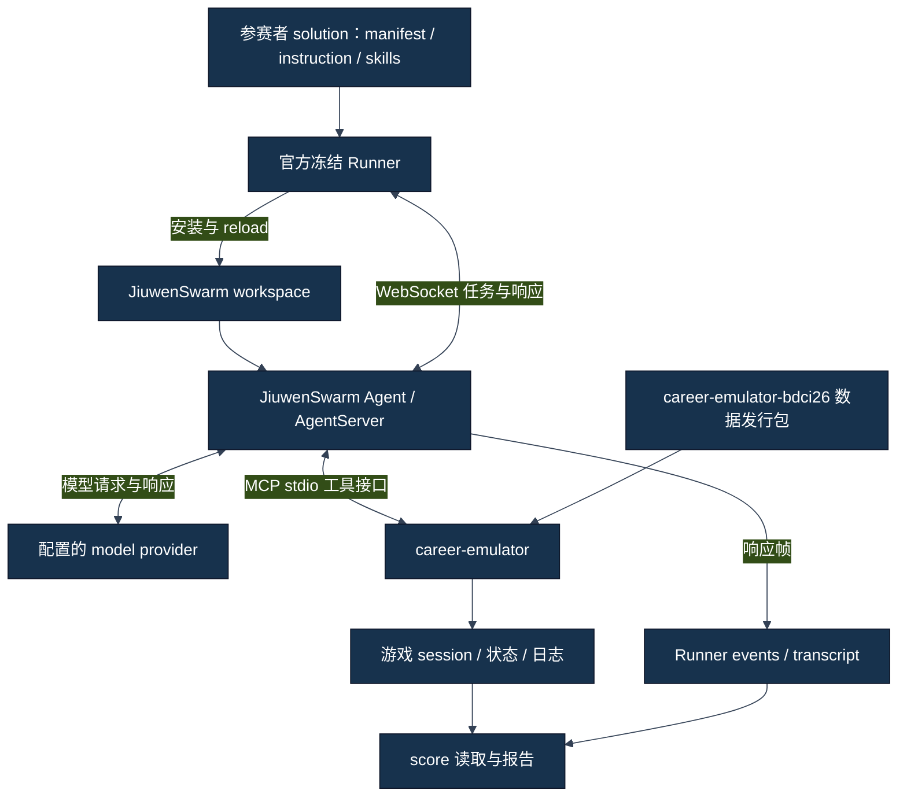

# 比赛官方到底提供了什么

## 本 Track 怎么读

这条路线追踪真实运行需要的组件。JiuwenSwarm 承载 Agent（智能体），AgentServer 接收任务并返回事件，MCP 连接工具与模拟器；Runner 把准备好的任务交给服务并收集运行记录。先定位各组件，再沿安装和动作链阅读。

主线：[比赛官方到底提供了什么](01-比赛官方到底提供了什么.md) → [从零搭好 Python 与依赖环境](02-从零搭好Python与依赖环境.md) → [JiuwenSwarm、AgentServer 与 MCP 分别是什么](04-JiuwenSwarm、AgentServer与MCP分别是什么.md) → [Submission 校验与 Skill 安装](03-Submission校验与Skill安装.md#检查之后材料怎样进入框架) → [Runner、Tool 调用与状态更新](05-Runner、Tool调用与状态更新.md#一次选择怎样成为外部动作) → [日志、Session、Score 与证据是怎么产生的](06-日志、Session、Score与证据是怎么产生的.md)。

按需查询：[工程排障与完整运行链复现](07-工程排障与完整运行链复现.md)。

四条路线与统一术语见[从这里开始](../00-从这里开始.md)。

**事实** 的主要入口是[官方来源锁](../../project/OFFICIAL_SOURCE_LOCK.md)、[pyproject](../../../pyproject.toml)和冻结 Runner 源码。这里讲已锁定的历史官方合同，不重新确认今日赛程、门户状态或最新包版本。

## 官方不是只给一个现成 Agent

“官方给一个 Agent，我们把 Skill 插进去”省略了运行所必需的很多组件。Agent（智能体）需要框架组织上下文、调用模型和工具；游戏需要自己的状态与数据；Runner（驱动程序）需要安装、发送任务、收集输出和构建评分报告；参赛者还要给出一个可识别方案。

**解释**：更准确的理解是，官方提供一套参赛接口与运行链。参赛者提交行为规则及设计材料，JiuwenSwarm 按其配置组织 Agent 执行，career-emulator 处理游戏工具，Runner 负责外围编排。任何一层失效，都可能表现为“游戏没跑起来”，但修复位置不同。

## 总体组件图



图中深色节点是组件，箭头是职责关系，不是精确进程树。模型服务、AgentServer 与 emulator 不是同一个东西；MCP 连接 Agent 的工具能力，WebSocket 连接 Runner 的任务驱动。右下评分还有 DB 与文本回退，见第八章。

## 官方／upstream 与项目自建

| 对象 | 来源与职责｜FACT | 不负责什么 |
|---|---|---|
| `openJiuwen-ai/CareerSim-BDCI26` | 官方参赛仓库，提供 Runner、示例、依赖与提交合同 | 不等于本项目自己的全部治理文档 |
| frozen Runner | 该仓库 SHA `f61c738…` 的外围安装、驱动、记录、评分代码 | 不包含我们每个候选的最佳动作策略 |
| `jiuwenswarm` | Agent runtime / service layer（智能体运行时／服务层） | 不等于职业游戏本身 |
| `career-emulator` | 游戏环境与 MCP backend（工具后端）包 | 不等于赛事数据发行版 |
| `career-emulator-bdci26` | 比赛事件／配置数据发行包 | 没有独立顶层 Python module 不代表未安装 |
| participant solution（参赛方案） | 自己的 manifest、instruction、Skills 和设计材料 | 不替代框架、解释器或官方 Runner |
| project-built 运行／审计脚本 | 本项目包装身份、处理运行证据、离线审计 | 不是官方原生能力，也不自动获运行权限 |
| project governance（项目治理） | 权限、shared runtime、hold、Git 交付约定 | 不改变游戏隐藏规则或云端评测 |

**事实**：[ENVIRONMENT](../../project/ENVIRONMENT.md)记录三项不同发行版：jiuwenswarm 0.2.4b3、career-emulator 1.0.1、career-emulator-bdci26 1.0.0。Distribution（发行版）是安装与版本管理对象；module（模块）是 Python 可导入的代码名字。数据发行版可以不提供同名可导入模块。

## 公开 Dev 与保密 Test

Dev（公开开发集）用于开发验证，Test（保密测试集）用于正式评分，这是来源锁核验的官方划分。公开开发轨迹可以支持具体动作行为与工程诊断，不能证明隐藏 Test 的成绩、分布或迁移收益。

**解释**：读者容易把本地 score 看成官方比赛总成绩，但本地脚本生成的报告与云端受理、隐藏集评测、专家评审有不同来源。源码里的 competition partial score 也不能自动替代所有赛事评价项。我们不在这里猜隐藏事件、阈值或评测概率。

**教学示例（非历史运行记录）：** 某次本地 Dev 模拟完成并出现 70 分，尚无门户回执。正确陈述是“该身份在该本地样本观测到该结果”；错误陈述是“官方已经认可 70 分，说明隐藏集也能到 70”。

## 历史 submission layout

Submission（提交材料）不是整份开发仓库。来源锁记录的历史结构是：

```text
solution/
  manifest.json
  README.md
  design/
    skills_design.md
    decision_report.md
  skills/
    skill-name/
      SKILL.md
```

`manifest.json` 描述团队、名称、运行模式与 instruction；`skills/` 放模块正文；README 和 design 面向复现／设计说明。`docs/skill-evolution` 是项目保存历史原件与教学的目录，**不是比赛 submission layout**。把该目录整体打包也不会自动变成合法 solution。

**事实**：Runner 校验只覆盖它实现的材料条件，不能代表全部比赛文档要求或平台受理。比如 `validate_submission_contract` 并不验证 design 两文件和整个比赛 ZIP 合同；第三章细分检查范围。

## 为什么冻结官方源身份

冻结 SHA 回答“教程解释的是哪一份程序”。包版本回答“用哪份框架、模拟器、数据”。Candidate（候选身份）回答“装哪份 participant 行为”。它们彼此关联，但不能用一个 SHA 代替全部。

**事实**：[CURRENT_STATE](../../project/CURRENT_STATE.md)的最终包是 exact-v6，当前 checkout 的行为是历史 v8a，二者不同。Track A 绑定最终 v6 的内部规则；Track B 解释它们共同使用的冻结官方外围链路，不把当前四 Skill 反投为最终三 Skill。

**解释**：锁身份是为了可比较、可恢复和定位问题，不是证明源代码从此没有缺陷。后文会看到校验覆盖、评分 fallback 与续跑边界的限制。我们解释这些事实，本任务不修 frozen Runner。

## 自测

一份 `SKILL.md` 能否替代 career-emulator？一个发行版没有同名 module 能否说它不存在？当前工程四 Skill 能否证明最终 ZIP 也是四 Skill？

参考分析：规则文件提供行为方法，不能执行游戏状态机；发行版与导入模块不是同一对象；最终 ZIP 要按冻结身份核对。只有分清这些对象，下一章谈 Python 与依赖才不会把“装好了一个包”理解成“全部系统已完成”。
