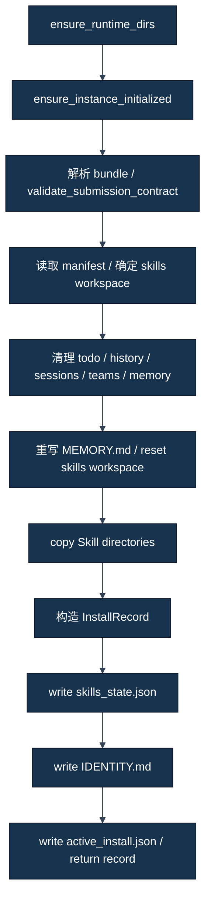

# Submission 校验与 Skill 安装

[四条学习路线与术语](../00-从这里开始.md) · [本 Track 入口](01-比赛官方到底提供了什么.md)

准备一个材料包时，先要回答“文件是否符合输入合同”，再回答“这些文件到了哪里，运行时会读哪份”。这两个问题沿着同一批文件展开，但检查与安装的权限不同。先看清单和校验函数，再跟着安装流水线追踪实际副本。

## 按问题跳读

- [材料怎样通过检查](#材料怎样通过检查)
- [检查之后，材料怎样进入框架](#检查之后材料怎样进入框架)

## 材料怎样通过检查

源码依据为冻结 [skill_contract.py](../../../career_sim_runner/skill_contract.py)、[validate.py](../../../career_sim_runner/validate.py)、[models.py](../../../career_sim_runner/models.py)与 [cli.py](../../../career_sim_runner/cli.py)。**事实** 表示源码实际检查；为什么拆层属于 **解释**。本轮只阅读源码，不运行这些环境校验入口。

### Bundle 是可搬运的材料，不是运行中的 Agent

Bundle（材料包）是一组按合同组织的文件。Runner 把目录视为输入，识别 manifest 和 Skill，再安装进框架工作区。开发仓库中的 `configs/runtime_manifest.json` 不是天然位于比赛布局里；项目 builder（构建脚本）可以生成 `solution/manifest.json`，但 builder 是项目自建工具，不能当 Runner 自己会自动寻找每个候选配置。

最小 Runner bundle 识别需要至少一个 `skills/<目录>/SKILL.md`；历史正式比赛材料还需 README、design 等，见[第一章](01-比赛官方到底提供了什么.md)。通过低层识别只说明文件形状被支持，不说明正式材料齐全。

### Manifest 的字段与两种 mode

Manifest（清单）使用 JSON（一种结构化文本格式），提供方案元数据与运行指令。

| 字段 | 源码如何使用｜FACT | 容易误解的地方 |
|---|---|---|
| team | `validate_manifest` 拒绝空白和已知占位团队名；用于日志标签优先项 | 不检查团队是否已在平台注册 |
| name | 标签备用项；team/name 都没有时用目录名 | 不用它独立认证 Candidate 或 Git commit |
| mode | 校验是否在 agent/team 集合；`resolve_run_mode` 再用于驱动请求 | 官方支持 team 不等于本项目启用 Team/Swarm |
| instruction | 安装时转为文本，规范化后写入 IDENTITY | `validate_manifest` 没有检验策略语义与遵循能力 |

`submission_mode=skill_bundle` 是 Runner 对材料布局的内部识别；`manifest.mode=agent` 是 JiuwenSwarm 的执行模式。两个字段不能互换，不能为了表达“我是 Skill 包”把 manifest.mode 填 `skill_bundle`。

**事实**：此 frozen validator 对 instruction 没有完整类型或内容合同检查，也不会证明其中的模型指令可执行、安全或有效。正式方案仍要遵循项目及比赛要求，不能把检查缺口当任意输入的推荐做法。`validate_manifest` 输入已解析字典，输出错误列表；它为完整材料校验提供团队/模式最低字段检查，不认证平台注册、策略内容或实际执行。

### Frontmatter 是给框架看的入口说明

Frontmatter（前置元数据）位于 SKILL.md 最前面，用 YAML（一种键值文本格式）描述 name 与 description。正文再写职责、触发与边界。

**教学示例（非历史运行记录）：** 下列目录名与 metadata 同为 sample-facts，仅教格式，不是比赛已安装模块：

```yaml
---
name: sample-facts
description: "整理已取得的公开事实，不提交动作。"
---
```

`validate_skill_frontmatter(skill_dir)` 输入一个 Skill 目录；先确认 SKILL.md 存在、文件以 `---` 开始且有结束标记，再用 `yaml.safe_load` 解析；name 和 description 必须有真值。输出错误文字列表，空列表表示它实现的检查通过。它用于识别框架所需的最小元数据入口，不负责正文质量、模型加载或 gameplay。

**解释**：description 是用途入口，不是 Skill 已应用的证明。源码也没有证明 name 必须与目录名相等，或正文每项规则都无冲突；教程建议一致命名是为了可识别，不能写成 validator 已强制这些附加条件。

### 三个校验层级不能合成一个万能 PASS

#### validate_submission_contract：低层布局合同

输入 submission 目录；解析真实路径，用 `list_bundle_skill_ids` 枚举直接子目录中具有 SKILL.md 的项并排序，确认支持的 bundle、manifest 文件和 skills 目录存在。加载 JSON manifest，返回标准化 details：目录、label、manifest、submission_mode、skill_ids。布局不符合时抛 `SubmissionError` 等错误。

这个函数为安装和完整材料检查提供共同入口：输入是 submission 根目录，输出是标准化 details 字典；布局不符时抛异常。它不负责 manifest 字段合法性、frontmatter、正文策略、运行环境、模型或游戏结果，也不负责官方受理。

**事实**：它没有调用 `validate_manifest` 或 `validate_skill_frontmatter`，更不启动框架。单独 `install_submission` 使用此低层函数，因此不能假设 install 已执行完整字段和前置元数据校验。

#### validate_submission：材料检查报告

输入目录；先做低层合同，再检查 team/mode 和每个实际枚举 Skill 的 frontmatter，返回 `ValidationReport`。布局失败时记失败并提前返回；字段与 frontmatter 错误追加为 checks。`report.ok` 是所有检查均真。

为什么存在：把布局、manifest 与每 Skill 错误汇总，便于在安装之前修材料。它不负责环境连通、模型调用、游戏效果、正文策略、design 完整性或平台受理。

#### validate_environment / validate_all：本机运行检查

`validate_environment` 输入可选 WS URL 与 DB path，创建 runtime 目录、必要时初始化 instance、覆盖实例 env，检查工具路径、数据文件、配置文字、DB 对齐／可写、Skill 根与 WebSocket 可达，再返回报告。`validate_all` 合并材料与环境报告；CLI `validate` 走这一层。

**事实**：DB 可写检查会建父目录、写再删 `.write_probe`；env overlay 可能写实例文件；backend check 会建立 WebSocket 连接。没有“validate”这个名字能取消这些副作用。当前 S11 没执行它。

### 合法／不合法材料的具体例子

**教学示例（非历史运行记录）：** 构造一个仅说明 Runner 材料检查的目录：

```text
solution/
  manifest.json
  skills/sample-facts/SKILL.md
```

构造 manifest：

```json
{
  "team": "教学团队甲",
  "name": "example-only",
  "mode": "agent",
  "instruction": "仅使用当前公开事实，唯一 Agent 提交动作。"
}
```

配合上一节合法 frontmatter，可满足这几个材料检查；**不是正式比赛完整提交，也不是本轮运行验证结果**。若删 manifest，布局失败；若 team 空白或 mode 写成 skill_bundle，字段失败；若前置块无 description，frontmatter 失败；若只放普通 README 而没有任一 SKILL.md，连 bundle 都无法识别。

一个细微反例：manifest 存在、目录中有 SKILL.md，但 YAML 格式错误。低层 `validate_submission_contract` 可以识别布局，`validate_submission` 会报前置元数据失败。不能看到前一函数通过就说“全部校验已过”。

### Environment PASS 的有限含义

`mcp_config.py` 的 `config_mentions_career_emulator` 只检查配置文本同时包含服务器名与可执行名；`env_mentions_db` 只检查路径文字出现。`setup.tool_availability` 用 PATH 找 jiuwenswarm-start，再检查同目录 launcher 文件。它们不完成真正 MCP initialize/list_tools，也不证明 AgentServer 子进程环境能解析命令。

`check_backend` 证明一条 WebSocket 可建立，不证明 model provider 成功、所有工具注册成功或 Skill 正文已读。数据检查确认指定 failure_conditions 目录有 json/data 文件，不认证整个隐藏集或数据完整摘要。

**事实**：S03 的历史注册故障表明“配置里写了命令”与“服务真的注册五个工具”不同；第九章给出精确来源。`play_headless` 还只把 environment report 的 backend-reachable 失败当阻断，不把所有 checks 自动 fail closed。那是 frozen 源码行为，不是建议忽略其他必要硬门禁。

### validation PASS 不等于运行或评分通过

```text
材料 VALIDATED
≠ 已复制 INSTALLED
≠ 框架发现 DISCOVERED
≠ 正文读取 LOADED
≠ 动作使用 APPLIED
≠ gameplay 完成
≠ 官方 hidden score / 平台验收
```

**解释**：每个命题都要不同证据。字段格式通过，只能消除该类错误；它不能补上后续服务、工具、session 或行为证据。也不能因为一局低分就否定前面的材料检查，它可能完全通过但策略或执行出问题。

### 自测与边界

为什么坏 frontmatter 可能通过低层 contract，却被 validate_submission 拒绝？为什么 CLI validate 不能放入本轮纯离线命令？为什么 manifest.mode=team 并不授权本项目多 Agent？

参考分析：函数检查范围不同；环境校验会初始化、写文件并连服务；官方支持集合与项目路线／任务权限不同。下面沿实际安装顺序看复制、注册与指令写入。

前面的校验最多确认它实现的那些条件。安装随后把输入目录中的材料复制到框架工作区，并写入登记与回执。沿着下面的真实顺序，才能判断哪一份文本成为运行输入。

## 检查之后，材料怎样进入框架

源码依据为 [install.py](../../../career_sim_runner/install.py)、[paths.py](../../../career_sim_runner/paths.py)、[setup.py](../../../career_sim_runner/setup.py)、[identity 模板](../../../career_sim_runner/prompts/identity.md)与 [normalize_text](../../../career_sim_runner/utils.py)。**事实** 是源码步骤；框架内部持续加载的说明只按源码注释合同表述。本轮没有 install 或 reload。

### 安装不是读一下原文件

Install（安装）把 participant bundle 变成框架工作区中的实际材料，写注册状态、指令文件和当前安装回执。源仓库里的 Skill、solution 中的 Skill 和 JiuwenSwarm 中的 Skill 是三份可能不同的文件，不能用源文件 hash 自动证明运行副本一致。

**解释**：安装既是部署材料，也是清理旧运行状态。这解释了为什么它属于需要明确许可的 runtime 写入，而不是纯文件查看。不同 Git checkout 可以共同指向同一个用户实例，安装新方案会影响其他运行。

### install pipeline：真实顺序



这是文件安装顺序，不包含服务启动、模型使用或 MCP game call。尤其前两步在材料合同校验之前发生：无效材料不意味着函数完全零副作用。reload 是带 submission 的 play 后续步骤，不在 install 函数内部。

### 核心函数的五个问题

| 维度 | install_submission 的源码合同 |
|---|---|
| 输入 | submission_dir，及可选 skills_dir |
| 主要步骤 | 目录／实例准备、低层合同、旧状态清理、复制、注册、身份与回执写入 |
| 输出 | `InstallRecord`，同时留下本机文件副作用 |
| 为什么存在 | 将可搬运 solution 转成框架能够发现和使用的本机布局 |
| 不负责 | 完整正文策略审查、服务就绪、模型调用、自动证明 LOADED/APPLIED、比赛上传 |

低层合同只识别布局与 manifest；[第三章](03-Submission校验与Skill安装.md)已说明完整字段／frontmatter 校验在 validate_submission。未来复现不能为了省步骤把“install 成功”代替材料预检。

### 目标位置怎样解析

默认实例名是 `career_emu`。`paths.py` 默认 JiuwenSwarm data root 位于用户目录 `.jiuwenswarm-instances/career_emu`；如果进程显式设置 `JIUWENSWARM_DATA_DIR`，框架数据路径助手使用该 override。默认 Skill 位置为：

```text
<JiuwenSwarm data root>/agent/workspace/skills/<skill-name>/
```

与此不同，Runner 的 active-install 与 last-session 等指针位于当前 repo 的 `.career_sim_runner/career_emu/`。源码参数和环境变量可以影响一些位置，**但不能仅凭 worktree 或一个 skills_dir 参数宣称全部运行链已隔离**：registry 和 IDENTITY 的写入仍通过默认 data path 助手，实例初始化与 DB／服务还另有路径。

**教学示例（非历史运行记录）：** 两个 checkout 甲、乙各有自己的 `.career_sim_runner` 回执，却共享同一个用户 `career_emu` 工作区。甲的 active_install 写“装了甲”，乙随后替换实际 Skill。甲回执仍在，不证明现在执行的还是甲。正确隔离要核对全部有效路径与服务，而不是给 Git 分支换名字。

### 为什么会清理旧状态

源码以 skills workspace 相邻路径定位 todo、`.agent_history`、sessions、`.agent_teams` 和 memory：对指定 glob 匹配的文件删除，对目录递归删除；memory 仅清理匹配 `*.md` 的项，再写入通用 `MEMORY.md`。随后 `_reset_skills_workspace` 清理 Skill 根中的其他子目录／文件，暂留 skills_state.json 待更新。

**事实**：这些是本机实际删除／替换，不是只改一个 enabled 标志。源码没有在这里删除整个游戏 SQLite DB，也没有证明它重置所有框架状态。清理 sessions 文件与清空游戏 session 表是不同动作，不能把一个扩大成另一个。

**解释**：清理旧工作材料可减少残留干扰，同时可能覆盖恢复／审计还依赖的唯一来源。项目后来约束 shared runtime（共享运行时）串行、安装前必要保全和 FORENSIC_HOLD，属于项目治理；不是官方函数自己自动完成证据保全。

没有任何本章示例执行删除。未来获准 install 前必须按具体任务检查仍有价值的证据与共享依赖；不能照教材把整个用户目录当可随意清理的缓存。

### _install_skill_bundle：复制的是整个目录

输入已识别 submission root 与目标 skills root，按 `list_bundle_skill_ids` 排序取得直接子目录名。对每个名字执行 `shutil.copytree(source/skills/name, target/name)`，返回 participant_skill_names 列表。

因此源目录内除 SKILL.md 之外的附属文件也可能一起复制，安装不是只摘 frontmatter。这里不自动把它编译成 Python，也不自行执行正文中的动作。目标通常已 reset，否则已有同名目录可使 copytree 报错；错误不等于前面清理被事务回滚。

**教学示例（非历史运行记录）：** `solution/skills/sample-facts/` 含 SKILL.md 与 `examples.md`。整个目录复制到 workspace；正确结论是两份文件部署了，不是模型已经读完 examples，也不是文件中的建议已执行。源码没有让附属文本自动成为每个模型调用的全部上下文。

### skills_state.json：登记与开关

`_write_skills_state` 读取现有 JSON 或从默认对象开始，保留／补上 marketplaces，把 installed_plugins 置空，重写 local_skills 与 skill_configs。核心形状如下。

**教学示例（非历史运行记录）：** 路径为教学抽象，非当前安装快照：

```json
{
  "marketplaces": [],
  "installed_plugins": [],
  "local_skills": [
    {"name": "sample-facts", "origin": "<data>/agent/workspace/skills/sample-facts", "source": "project", "enabled": true}
  ],
  "skill_configs": {"sample-facts": {"enabled": true}}
}
```

local_skills 列出安装目录；origin 指向那份副本；enabled 表示登记为启用；source=project 描述来源；skill_configs 给每个名字启用配置。清单由这次 participant 集合重建，不是无限追加旧方案。

**解释**：注册信息支持框架发现路径，仍不是读取正文的回执。S02 的历史证据另外用 skill_tool result 证明 LOADED、工具参数与游戏日志标记证明 APPLIED；第九章分别解释五个命题。

### IDENTITY.md：instruction 怎样进入工作区

`_write_identity_md` 输入安装 Skill 名字与 manifest。读取 Runner 的 identity 模板，将名字规范化并列成项目符号；取 manifest.instruction，strip 后经 `normalize_text` 处理；未给指令则使用默认提示；填模板，再写到 `<data>/agent/workspace/IDENTITY.md`。

模板还包含官方身份、已安装技能列表、参赛者指令、不得二次 new_game、observe→take_action 流程和恢复提示。参赛者 instruction 不是整个 system prompt，也不是 play prompt：它是模板的一个区块；不同来源的常驻规则必须保持相容。

**FACT｜源码注释合同**：此函数注释称内容经 `ContextAssembleRail` 在每次模型调用的 system prompt 中持续存在、跨越 context compression（上下文压缩）。本教程只按该注释定义表述，不独立证明 JiuwenSwarm 所有内部拼装路径、每次实际调用内容或正文自动重读。`IDENTITY.md` 存在更不代表三个 Skill 的详细正文在压缩后都保留。

`normalize_text` 会过滤特殊包装和部分字符、收束过长反引号序列。它不总是原 instruction 的逐字节复制；因此核对 IDENTITY 应按官方渲染路径，不把 raw instruction 文本直接对等成最终模板 bytes。最终 exact-v6 历史原件仍不应为“看起来一致”而改写。

### active_install.json：回执不是实时状态证明

安装构造 `InstallRecord`，记录源目录、label、目标 Skill 路径、skill_name=`submission-skills`，并在 manifest 中加入内部 submission_mode 和 participant_skill_names。它写到 Runner runtime 的 active_install.json，供后续 `load_active_install` 使用。

这里 skill_name 是通用包标记，不是声明只有一个比赛 Skill。记录也没有自动包含 Git source commit、全文件 hash、模型配置或完整数据库身份；项目需要额外 Candidate 和 evidence provenance（来源链）。

**教学示例（非历史运行记录）：** 当前目录留有旧 active_install，但用户目录的 Skill 已被另一个安装替换。正确做法是核对实际副本、registry、IDENTITY 与服务配置；错误做法是把回执直接当“当前 Agent 一定加载这个版本”。

### 安装、reload、应用与恢复各有一步

`install_submission` 写文件；`reload_agent_config` 在已运行 AgentServer 上发送 reload 请求；启动／发现阶段暴露 Skill 信息；模型读取正文是 LOADED；实际按规则提交是 APPLIED。exact-v6 恢复还要求重读三份及重建状态，见 [Track A](../track-a-skill/02-exact-v6-Instruction逐句拆解.md)。不能把“IDENTITY 持续存在”的注释代替恢复遵循证据。

自测：复制成功能否证明已用 Skill？重写 registry 是否会保持原 installed_plugins？删 session 文件是否等于删除游戏 DB？一个自定义 skills_dir 是否自动隔离框架？

参考分析：不能；源码清空 installed_plugins；两种状态不同；路径参数只覆盖部分目标。把这些边界解释清楚，才理解项目为什么对 install 与共享运行如此谨慎。
