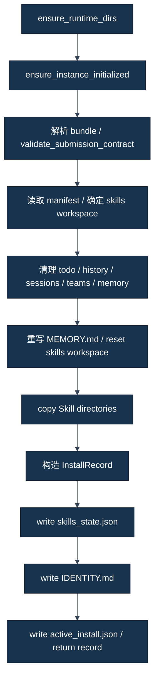

# 04｜Skill 是怎样真正安装进 JiuwenSwarm 的

[学习地图](00-学习地图.md) · [上一章：校验](03-Submission、Manifest与Skill校验.md) · [下一章：服务与 MCP](05-JiuwenSwarm、AgentServer与MCP分别是什么.md)

本章直接依据 [install.py](../../../career_sim_runner/install.py)、[paths.py](../../../career_sim_runner/paths.py)、[setup.py](../../../career_sim_runner/setup.py)、[identity 模板](../../../career_sim_runner/prompts/identity.md)与 [normalize_text](../../../career_sim_runner/utils.py)。**FACT** 是源码步骤；框架内部持续加载的说明只按源码注释合同表述。本轮没有 install 或 reload。

## 1. 安装不是读一下原文件

Install（安装）把 participant bundle 变成框架工作区中的实际材料，写注册状态、指令文件和当前安装回执。源仓库里的 Skill、solution 中的 Skill 和 JiuwenSwarm 中的 Skill 是三份可能不同的文件，不能用源文件 hash 自动证明运行副本一致。

**INTERPRETATION**：安装既是部署材料，也是清理旧运行状态。这解释了为什么它属于需要明确许可的 runtime 写入，而不是纯文件查看。不同 Git checkout 可以共同指向同一个用户实例，安装新方案会影响其他运行。

## 2. install pipeline：真实顺序



这是文件安装顺序，不包含服务启动、模型使用或 MCP game call。尤其前两步在材料合同校验之前发生：无效材料不意味着函数完全零副作用。reload 是带 submission 的 play 后续步骤，不在 install 函数内部。

## 3. 核心函数的五个问题

| 维度 | install_submission 的源码合同 |
|---|---|
| 输入 | submission_dir，及可选 skills_dir |
| 主要步骤 | 目录／实例准备、低层合同、旧状态清理、复制、注册、身份与回执写入 |
| 输出 | `InstallRecord`，同时留下本机文件副作用 |
| 为什么存在 | 将可搬运 solution 转成框架能够发现和使用的本机布局 |
| 不负责 | 完整正文策略审查、服务就绪、模型调用、自动证明 LOADED/APPLIED、比赛上传 |

低层合同只识别布局与 manifest；[第三章](03-Submission、Manifest与Skill校验.md)已说明完整字段／frontmatter 校验在 validate_submission。未来复现不能为了省步骤把“install 成功”代替材料预检。

## 4. 目标位置怎样解析

默认实例名是 `career_emu`。`paths.py` 默认 JiuwenSwarm data root 位于用户目录 `.jiuwenswarm-instances/career_emu`；如果进程显式设置 `JIUWENSWARM_DATA_DIR`，框架数据路径助手使用该 override。默认 Skill 位置为：

```text
<JiuwenSwarm data root>/agent/workspace/skills/<skill-name>/
```

与此不同，Runner 的 active-install 与 last-session 等指针位于当前 repo 的 `.career_sim_runner/career_emu/`。源码参数和环境变量可以影响一些位置，**但不能仅凭 worktree 或一个 skills_dir 参数宣称全部运行链已隔离**：registry 和 IDENTITY 的写入仍通过默认 data path 助手，实例初始化与 DB／服务还另有路径。

**TEACHING EXAMPLE｜教学示例，不是历史 Run 原始记录。** 两个 checkout 甲、乙各有自己的 `.career_sim_runner` 回执，却共享同一个用户 `career_emu` 工作区。甲的 active_install 写“装了甲”，乙随后替换实际 Skill。甲回执仍在，不证明现在执行的还是甲。正确隔离要核对全部有效路径与服务，而不是给 Git 分支换名字。

## 5. 为什么会清理旧状态

源码以 skills workspace 相邻路径定位 todo、`.agent_history`、sessions、`.agent_teams` 和 memory：对指定 glob 匹配的文件删除，对目录递归删除；memory 仅清理匹配 `*.md` 的项，再写入通用 `MEMORY.md`。随后 `_reset_skills_workspace` 清理 Skill 根中的其他子目录／文件，暂留 skills_state.json 待更新。

**FACT**：这些是本机实际删除／替换，不是只改一个 enabled 标志。源码没有在这里删除整个游戏 SQLite DB，也没有证明它重置所有框架状态。清理 sessions 文件与清空游戏 session 表是不同动作，不能把一个扩大成另一个。

**INTERPRETATION**：清理旧工作材料可减少残留干扰，同时可能覆盖恢复／审计还依赖的唯一来源。项目后来约束 shared runtime（共享运行时）串行、安装前必要保全和 FORENSIC_HOLD，属于项目治理；不是官方函数自己自动完成证据保全。

没有任何本章示例执行删除。未来获准 install 前必须按具体任务检查仍有价值的证据与共享依赖；不能照教材把整个用户目录当可随意清理的缓存。

## 6. _install_skill_bundle：复制的是整个目录

输入已识别 submission root 与目标 skills root，按 `list_bundle_skill_ids` 排序取得直接子目录名。对每个名字执行 `shutil.copytree(source/skills/name, target/name)`，返回 participant_skill_names 列表。

因此源目录内除 SKILL.md 之外的附属文件也可能一起复制，安装不是只摘 frontmatter。这里不自动把它编译成 Python，也不自行执行正文中的动作。目标通常已 reset，否则已有同名目录可使 copytree 报错；错误不等于前面清理被事务回滚。

**TEACHING EXAMPLE｜教学示例，不是历史 Run 原始记录。** `solution/skills/sample-facts/` 含 SKILL.md 与 `examples.md`。整个目录复制到 workspace；正确结论是两份文件部署了，不是模型已经读完 examples，也不是文件中的建议已执行。源码没有让附属文本自动成为每个模型调用的全部上下文。

## 7. skills_state.json：登记与开关

`_write_skills_state` 读取现有 JSON 或从默认对象开始，保留／补上 marketplaces，把 installed_plugins 置空，重写 local_skills 与 skill_configs。核心形状如下。

**TEACHING EXAMPLE｜教学示例，不是历史 Run 原始记录。** 路径为教学抽象，非当前安装快照：

```json
{
  "marketplaces": [],
  "installed_plugins": [],
  "local_skills": [
    {"name": "sample-facts", "origin": "<data>/agent/workspace/skills/sample-facts", "source": "project", "enabled": true}
  ],
  "skill_configs": {"sample-facts": {"enabled": true}}
}
```

local_skills 列出安装目录；origin 指向那份副本；enabled 表示登记为启用；source=project 描述来源；skill_configs 给每个名字启用配置。清单由这次 participant 集合重建，不是无限追加旧方案。

**INTERPRETATION**：注册信息支持框架发现路径，仍不是读取正文的回执。S02 的历史证据另外用 skill_tool result 证明 LOADED、工具参数与游戏日志标记证明 APPLIED；第九章分别解释五个命题。

## 8. IDENTITY.md：instruction 怎样进入工作区

`_write_identity_md` 输入安装 Skill 名字与 manifest。读取 Runner 的 identity 模板，将名字规范化并列成项目符号；取 manifest.instruction，strip 后经 `normalize_text` 处理；未给指令则使用默认提示；填模板，再写到 `<data>/agent/workspace/IDENTITY.md`。

模板还包含官方身份、已安装技能列表、参赛者指令、不得二次 new_game、observe→take_action 流程和恢复提示。参赛者 instruction 不是整个 system prompt，也不是 play prompt：它是模板的一个区块；不同来源的常驻规则必须保持相容。

**FACT｜源码注释合同**：此函数注释称内容经 `ContextAssembleRail` 在每次模型调用的 system prompt 中持续存在、跨越 context compression（上下文压缩）。本教程只按该注释定义表述，不独立证明 JiuwenSwarm 所有内部拼装路径、每次实际调用内容或正文自动重读。`IDENTITY.md` 存在更不代表三个 Skill 的详细正文在压缩后都保留。

`normalize_text` 会过滤特殊包装和部分字符、收束过长反引号序列。它不总是原 instruction 的逐字节复制；因此核对 IDENTITY 应按官方渲染路径，不把 raw instruction 文本直接对等成最终模板 bytes。最终 exact-v6 历史原件仍不应为“看起来一致”而改写。

## 9. active_install.json：回执不是实时状态证明

安装构造 `InstallRecord`，记录源目录、label、目标 Skill 路径、skill_name=`submission-skills`，并在 manifest 中加入内部 submission_mode 和 participant_skill_names。它写到 Runner runtime 的 active_install.json，供后续 `load_active_install` 使用。

这里 skill_name 是通用包标记，不是声明只有一个比赛 Skill。记录也没有自动包含 Git source commit、全文件 hash、模型配置或完整数据库身份；项目需要额外 Candidate 和 evidence provenance（来源链）。

**TEACHING EXAMPLE｜教学示例，不是历史 Run 原始记录。** 当前目录留有旧 active_install，但用户目录的 Skill 已被另一个安装替换。正确做法是核对实际副本、registry、IDENTITY 与服务配置；错误做法是把回执直接当“当前 Agent 一定加载这个版本”。

## 10. 安装、reload、应用与恢复各有一步

`install_submission` 写文件；`reload_agent_config` 在已运行 AgentServer 上发送 reload 请求；启动／发现阶段暴露 Skill 信息；模型读取正文是 LOADED；实际按规则提交是 APPLIED。exact-v6 恢复还要求重读三份及重建状态，见 [Track A](../track-a-skill/02-exact-v6-Instruction逐句拆解.md)。不能把“IDENTITY 持续存在”的注释代替恢复遵循证据。

自测：复制成功能否证明已用 Skill？重写 registry 是否会保持原 installed_plugins？删 session 文件是否等于删除游戏 DB？一个自定义 skills_dir 是否自动隔离框架？

参考分析：不能；源码清空 installed_plugins；两种状态不同；路径参数只覆盖部分目标。把这些边界解释清楚，才理解项目为什么对 install 与共享运行如此谨慎。
