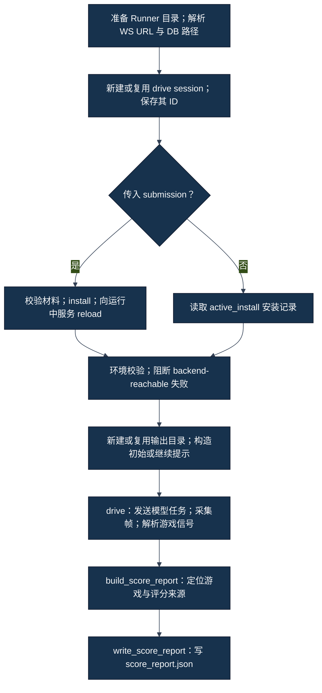
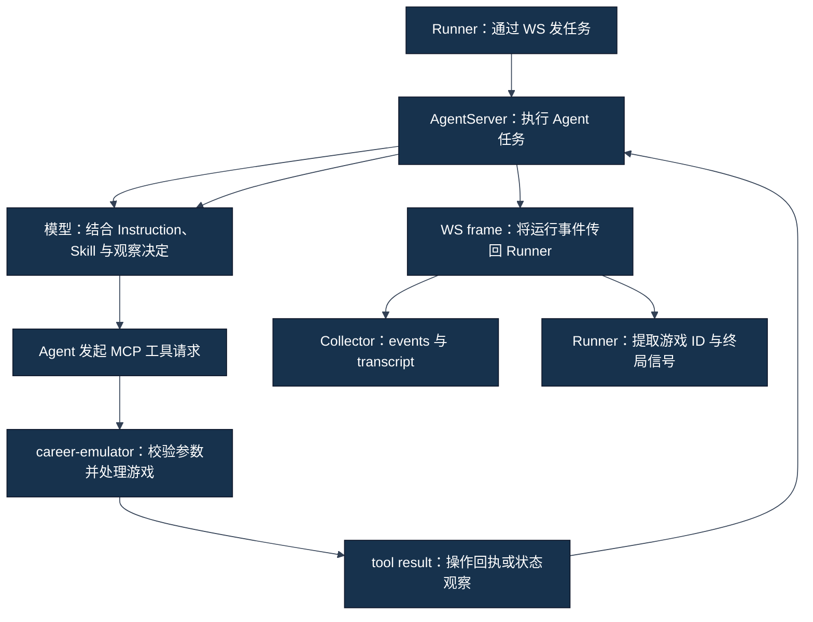

# Runner、Tool 调用与状态更新

[四条学习路线与术语](../00-从这里开始.md) · [本 Track 入口](01-比赛官方到底提供了什么.md)

模型写出一个选择，游戏并不会因此改变。一次正式运行需要先把任务交给服务，再由 Agent 发起工具请求，最后把工具结果带回判断。下面先看整局由谁驱动，再把镜头缩到一次动作；两种循环在同一条执行链上。

## 按问题跳读

- [整局任务怎样被驱动](#整局任务怎样被驱动)
- [一次选择怎样成为外部动作](#一次选择怎样成为外部动作)

## 整局任务怎样被驱动

### 先分清“启动服务”和“驱动游戏”

**事实**：官方冻结 Runner 的 [CLI（命令行入口）](../../../career_sim_runner/cli.py) 接收命令，调用 [play_headless（无界面运行编排）](../../../career_sim_runner/headless_play.py)，后者通过 WebSocket（双向消息连接）向已经运行的 AgentServer（代理服务）发送请求。`play_headless()` 本身不启动 JiuwenSwarm 服务。

服务启动见[第 04 章](04-JiuwenSwarm、AgentServer与MCP分别是什么.md)。Runner 发起的是“请 Agent 按提示完成游戏”的模型任务；真正创建 CareerSim 对局的是后续 MCP `new_game` 工具调用。

| CLI 子命令 | 官方源码中的作用 | 不能据此推导 |
|---|---|---|
| `setup` | 初始化实例、写入 MCP 配置并处理环境覆盖 | 服务已经就绪；原有绝对 executable 路径一定保留 |
| `validate` | 校验材料与环境，生成校验报告 | 无副作用；Skill 已被使用 |
| `install` | 复制 Skill、更新注册表与 IDENTITY、清理部分工作区状态 | 正在运行的 Agent 已经 reload；对局成功 |
| `play` | 选择连接、可选安装/reload、驱动模型、采集并尝试生成评分报告 | 自动启动服务；必然走满 48 月 |
| `score` | 从安装记录、输出路径和 DB/文本重新构造并写入报告 | 重新玩了一局；一定选中了目标 game session |
| `replay` | 读取事件并渲染回放；`--live` 是实时观察展示方式 | 重新执行历史工具动作；创建新游戏 |

`validate` 会有目录、实例初始化、环境覆盖、DB 父目录写入探针和连接检查等行为。`score` 的 fallback（后备路径）也不保证纯文件读取。不能因为名字像“检查”，便在未授权窗口执行。本轮只读上述源码。

### play_headless 的真实执行顺序

下图严格按冻结源码排列，特意保留了提前写入 drive session 的位置。Drive session（模型驱动会话）与 Game session（游戏会话）不是同一个 ID。



**事实**：[源码](../../../career_sim_runner/headless_play.py) 在材料校验之前保存 drive ID。因此一个 drive 指针文件存在，不证明已经调用 `new_game`。中途失败时，最后输出指针还可能指向旧 Run（一次运行）；S07-51 正是必须排除旧输出归属的历史例子，见[第 07 章](07-工程排障与完整运行链复现.md)。

环境校验的源码报告包含多项检查，但 `play_headless()` 只从失败项中挑选名为 `backend-reachable` 的项来阻断。这是冻结实现事实，不代表项目任务可以忽略自己的必要前置条件。项目另有 [LIVE_RUN_WORKFLOW](../../project/LIVE_RUN_WORKFLOW.md)，不应把项目门禁倒写成 Runner 原生实现。

#### 核心函数：play_headless()

| 问题 | 源码回答 |
|---|---|
| 输入 | 可选 submission 目录、WS URL、DB 路径、超时、是否继续、事件回调 |
| 主要步骤 | 按图准备身份；按分支安装或读取记录；校验连接；构造提示；调用 `drive()`；构造并保存评分 |
| 输出 | `ScoreReport` 对象与报告路径；异常也可能直接向上传播 |
| 为什么存在 | 把材料安装、模型驱动与产物生成连接成一个参与者入口 |
| 不负责什么 | 启动服务、保证 MCP 真正注册、保证模型遵循 Skill、保证官方云端有效性 |

### Prompt 怎样开始一局

Prompt（提示词）是发给模型的任务文本。[初始模板](../../../career_sim_runner/prompts/play_headless.md) 要求新建一局、输出 `SESSION_ID`、持续观察/行动、到结束时输出 ending score（终局评分）及 `DONE`。

**解释**：这是一份对模型的要求，并非 Runner 在 Python 中直接调用一串游戏动作。模型可能读错、提前结束或工具调用失败；这些都要从实际回执与状态验证。

[消息封装 `_build_envelope()`](../../../career_sim_runner/ws_client.py) 将提示放入 `content` 和 `query`，消息方法是 `chat.send`，附带 drive ID、`mode`、`work_mode="work"`、流式标记以及新的 request ID（请求编号）。此处 `session_id` 指 JiuwenSwarm 对话；游戏 ID 要等工具结果返回后另外提取。源码注释称省略 `work_mode` 可能触发旧路径；这是源码注释的定义，本章没有独立运行验证这一机制。

### drive 不是“发一句话就等最后分”

#### 核心函数：drive()

| 问题 | 源码回答 |
|---|---|
| 输入 | WS URL、提示、drive session、模式、全局超时、日志目录、可选回调 |
| 主要步骤 | 建立连接；发送任务；循环接收帧；交给 collector；提取游戏信号；判断模型结束/错误；必要时发送继续提示 |
| 输出 | `DriveResult`：退出码、终止原因、游戏 ID、采集到的 usage、文本、events 与 transcript 路径 |
| 为什么存在 | 让长游戏跨多个模型任务继续运行，同时把运行观察落盘 |
| 不负责什么 | 改写 Skill、替模型选择行动、计算游戏评分公式、证明每个工具请求都有正确的状态闭环 |

**事实**：[drive 源码](../../../career_sim_runner/ws_client.py) 将接收帧同时送到两个用途：`StreamCollector.feed_frame()` 记录可观察证据；`_extract_game_signals()` 更新 Runner 内部游戏摘要。两者使用同一帧，不等于其输出可以互相替代。

当模型任务报告完成、但内部摘要尚未判定游戏结束时，Runner 在同一个 drive session 中发送新的继续提示，使用新的 request ID。冻结上限 `MAX_CONTINUATIONS=20` 指最多 20 次自动继续请求，不是 20 个游戏动作，也不是允许另开 20 局。

源码有跳过紧随继续请求而来的重复完成帧的标志；收到非最终帧会清除该标志。不能仅凭一次继续上限耗尽，推断“这个标志永久卡住”或自行修补 Runner。

### 终局要看哪些信号

Structured result（结构化结果）是具有字段和类型的工具输出；模型普通文字可以任意生成。冻结解析器只从 `chat.tool_result`、`mcp_career-emulator_` 前缀和可解析的 `raw_output.result` 中读取下列信号：

- `new_game`：取得游戏 `session_id`。
- `observe`：取得游戏 ID、当前年/月；若 `simulation_flags.alive` 明确为 `false`，或 `failed` 明确为 `true`，标记结束。
- `take_action`：若 `success=false` 且错误以 `GAME OVER:` 开头，标记结束。

**事实**：内部 `_GameState` 在 `game_over` 后还把自身 `failed=true / alive=false`。这是 Runner 的停止标记，不应把它逐字当成游戏数据库的真实终局属性，也不能据此判定究竟是自然完成还是提前失败。

模型文本中的 `DONE`、`GAME OVER` 或“已完成 48 月”不参与该结构化终局判断。当前月份到 48 本身也不是这个解析器的独立停止条件。退出码 0 可以对应一个真实提前终局；历史 v4 在约 M6 因健康失败，但 Runner 返回 0。完整性与路线表现还需看目标游戏状态。

### 三种“继续/结束”不要混为一谈

| 概念 | 冻结实现的含义 | 要另外核实 |
|---|---|---|
| 模型任务结束 | 收到完成帧 | 游戏是否真的结束 |
| 自动继续 | 同一 drive 再发提示，使用本次已解析的游戏摘要 | 工具能否继续同一 game；是否触发上限 |
| CLI `--continue` | 读取上次 drive ID，尽可能复用输出目录 | 是否仍是目标安装、目标游戏、有效历史上下文 |

手动 `--continue` 调用的是 `build_continue_prompt(None)`；当前冻结实现只将模板中的游戏 ID 替换为 `unknown`，未在这一步完整填写年/月。它不是一个已验证的“从持久化游戏状态准确恢复”接口。指定 `--continue` **同时仍传入 submission** 会再次执行安装及其工作区清理，不能将其理解为没有副作用的重连。缺失的恢复保证应写 `UNKNOWN`，不以本轮 live probe 补证。

Timeout（超时）是一个 `drive()` 的全局墙钟预算，继续请求不会重新获得完整预算；默认值来自 [constants.py](../../../career_sim_runner/constants.py)。它与游戏的 48 月时间跨度无关。超时退出可能没有更细的 `termination_reason`，WebSocket 异常也可能直接逃出函数，导致最终 score report 根本没有生成。

### 阅读练习

**教学示例（非历史运行记录）：** 假设有一个 drive ID，模型写了“完成”，但最后一次工具观察显示仍存活、尚在 M8，随后继续预算耗尽。可下结论的是“驱动未观察到结构化终局”；不能写“游戏失败”“得到零分”或“Skill 完整遵循”。

Runner 能维持整局任务，却不替模型挑选游戏选项。进入 drive 内部后，还要区分模型文本、工具请求、回执和状态观察；这些对象决定一次选择是否真正落地。决策内容怎样组织，见 [Track A 的行动闭环](../track-a-skill/06-三Skill协同与一次Action闭环.md)。

## 一次选择怎样成为外部动作

### 一次决定经过哪些边界

LLM（大语言模型）生成内容，Tool call（工具调用）请求外部操作，MCP（模型上下文协议）把工具接口接到 career-emulator（游戏环境）。三者协作，但不是同一个执行者。



图中两种循环不同：Agent 与游戏之间进行决策/工具交互；Runner 从服务接收可观察帧并维持长任务。图是系统职责解释，具体 JiuwenSwarm 内部每一层回调、调度和模型请求拼装细节不在本轮来源范围，未恢复部分为 `UNKNOWN`。

**事实**：[ws_client.py](../../../career_sim_runner/ws_client.py) 发送的是模型任务，解析的是服务返回帧；[transcript.py](../../../career_sim_runner/transcript.py) 把帧内工具事件落盘。Skill 对模型应怎样决定的要求，见 [Track A](../track-a-skill/01-从零理解Agent、Instruction与Skill.md)；这里不重写这些策略规则。

### 六种对象的区别

| 对象 | 含义 | 能证明什么 | 主要限制 |
|---|---|---|---|
| Model text（模型文本） | 模型说出的解释、计划、结论 | 可观察到模型这样表述 | 不证明环境真的执行 |
| Tool call（工具调用） | 工具名、参数、请求关联信息 | 发起了外部操作请求 | 未必成功；请求内容可能非法 |
| Tool result（工具结果） | 由工具接口返回的回执/数据 | 该工具对请求的响应 | 回执可能只有成功标记，并不含完整状态 |
| External state（外部状态） | 游戏当前持久化/可观察状态 | 正确归属的最新观察可支持状态结论 | 需要游戏 ID 和时间顺序，不能拿另一局替代 |
| Transcript（文本记录） | Collector 整理的可读文本 | 便于追踪模型可见叙述 | 会丢失结构、类型和部分关联信息 |
| Structured event（结构化事件） | JSONL 中的事件类型、序号、时间与 payload | 便于定位工具、usage、完成帧 | 仍是采集视角；不自动等同全部后台事实 |

Frame（消息帧）是一次 WS 接收单位。一个帧可能嵌套多个事件；一个事件也不能简单当成一次独立游戏动作。Frame count、模型轮次、工具调用数与游戏月份是不同计数。

### “我选择 B”还缺哪些证据

**教学示例（非历史运行记录）：** 模型写：“我选择 B，以保留健康。”

这时只出现了模型文本。随后还必须有针对正确游戏与当前事件的合法 `take_action` 请求；工具回执要成功；需要新状态时还要取得该游戏后续的 `observe`。不能从这句话反推出参数、行动成功、健康变化或月份推进。

这里不展示一份猜测的完整 `take_action` schema（参数合同）。真实参数须以当时工具合同和当前事件为准，不能把 Skill 里的自然语言选项名称当作可提交枚举。历史 exact-v6 已有 Energy choice 6、7、3 被拒绝的案例，见[第 07 章](07-工程排障与完整运行链复现.md)。

#### 读取 Collector 事件时要保留外层与内层

**教学示例（非历史运行记录）：** 下列是简化的事件记录形状，不是完整服务协议或可执行 MCP 请求：

```json
{
  "seq": 12,
  "kind": "tool_result",
  "payload": {
    "event_type": "chat.tool_result",
    "tool_name": "mcp_career-emulator_observe",
    "raw_output": {"result": {"current_state": {"session_id": "example-game"}}}
  }
}
```

Collector 外层 `kind` 是便于审计的分类；`payload` 保留原事件节点；其中 `raw_output.result` 在真实源码中可以是 JSON 字符串或字典。图示省略 `ts` 等字段，不能直接拿这份教学片段做完整历史数据解析模板。Runner 提取信号时检查内层 `event_type` 与工具前缀，而不是寻找所有字符串里的“observe”。

### take_action receipt 与 fresh observe

Receipt（操作回执）回答“工具怎样处理这个请求”。Fresh observe（行动后新鲜观察）回答“这次操作后目标游戏当前是什么状态”。

**事实**：[RUN_HISTORY](../../project/RUN_HISTORY.md) 的 v7t / S08-RUN03 有 207 次行动、190 次观察，18 个行动回执缺少 `outcome`，且未得到可替代新观察的公开状态等价回执。这些回执只含成功/错误性质信息。`success=true` 不能自动提供下一事件、健康、月份、资源等完整观察。

**解释**：如果方案的状态板需要更新，应该依据正确游戏的返回状态和新观察。模型先前的计划、成功回执和事后猜测都不具备相同证据强度。具体“一行动一闭环”的策略要求在 [Track A 第 06 章](../track-a-skill/06-三Skill协同与一次Action闭环.md)。

Fresh 是时间关系，不是文件名。一个 `observe` 即使结构正确，若发生在行动之前、属于别的 session，或无法关联到该行动，就不能称为该行动的后置新观察。审计还要核对行动失败、重复回执和末尾终局等边界。

### Collector 怎样从帧生成证据

#### 核心函数：StreamCollector.feed_frame()

| 问题 | 源码回答 |
|---|---|
| 输入 | 一份服务返回的 frame 字典 |
| 主要步骤 | 递归寻找 usage、工具调用/结果节点；整理文本缓冲；在最终帧处记录完成状态 |
| 输出 | 追加 JSONL 事件、文本日志，更新 token 汇总，并可触发展示回调 |
| 为什么存在 | 将实时消息转成能回看、定位和离线分析的材料 |
| 不负责什么 | 执行工具、改变游戏、替游戏结算、自动验证 Skill 遵循 |

`_append_event()` 增加序号并写 UTC 时间戳；`_flush_text()` 写出文本缓冲；`feed_frame()` 在工具节点、文本换行或最终帧处强制刷新；`finalize()` 刷出余下文本。Stream（流式输出）的块边界是传输/整理边界，不是句子真实性的保证。

源码注释描述文本提取会跳过 reasoning 节点；本轮只确认源码的提取逻辑，不能扩张为“所有内部推理、敏感信息都绝不会进入日志”。归档仍需项目规定的范围选择和 secret scan（敏感信息扫描）。

### 看到工具事件，还不能直接做哪几种统计

- 多层 JSON 不能重复统计同一个嵌套节点；关联 ID 的去重规则须写清。
- `tool_call` 不是成功行动；要检查对应结果及 `success`。
- 最后一段模型文字不是官方评分；要检查 DB/终局来源。
- 能找到 Skill 名称，不等于正文被读入；要分别证明发现、加载和应用。
- 标记字符串的出现次数，不等于逐行动遵循；需逐项关联证据。

**事实**：S08-09 取证发现旧审计把大量带换行的合法候选内容标成 parser false negative（解析器误判为缺失/不合法）；同时确实存在不合法的 checkpoint 枚举。审计工具也会出错，不能拿它的汇总标签替代原始调用/回执。案例与来源见[第 07 章](07-工程排障与完整运行链复现.md)。

### 一个读者自检

**教学示例（非历史运行记录）：** 你有一份写着“已成功晋升”的 transcript，却没有对应工具结果，也不知道 game session。合适结论是“模型文本声称晋升，环境结果未被证实”。下一步应寻找已获准保留的正确事件和观察，不能为了补这份历史证据另开一局。

这些事件还需共同绑定 Candidate、drive、game 与输出目录，具体见[日志与评分来源](06-日志、Session、Score与证据是怎么产生的.md)。
