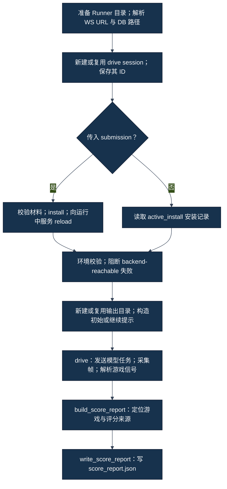

# 06｜Runner 如何启动并驱动一局 CareerSim

[学习地图](00-学习地图.md) · [上一章](05-JiuwenSwarm、AgentServer与MCP分别是什么.md) · [下一章](07-从模型决定到Tool调用再到新状态.md)

## 1. 先分清“启动服务”和“驱动游戏”

**FACT｜事实**：官方冻结 Runner 的 [CLI（命令行入口）](../../../career_sim_runner/cli.py) 接收命令，调用 [play_headless（无界面运行编排）](../../../career_sim_runner/headless_play.py)，后者通过 WebSocket（双向消息连接）向已经运行的 AgentServer（代理服务）发送请求。`play_headless()` 本身不启动 JiuwenSwarm 服务。

服务启动见[第 05 章](05-JiuwenSwarm、AgentServer与MCP分别是什么.md)。Runner 发起的是“请 Agent 按提示完成游戏”的模型任务；真正创建 CareerSim 对局的是后续 MCP `new_game` 工具调用。

| CLI 子命令 | 官方源码中的作用 | 不能据此推导 |
|---|---|---|
| `setup` | 初始化实例、写入 MCP 配置并处理环境覆盖 | 服务已经就绪；原有绝对 executable 路径一定保留 |
| `validate` | 校验材料与环境，生成校验报告 | 无副作用；Skill 已被使用 |
| `install` | 复制 Skill、更新注册表与 IDENTITY、清理部分工作区状态 | 正在运行的 Agent 已经 reload；对局成功 |
| `play` | 选择连接、可选安装/reload、驱动模型、采集并尝试生成评分报告 | 自动启动服务；必然走满 48 月 |
| `score` | 从安装记录、输出路径和 DB/文本重新构造并写入报告 | 重新玩了一局；一定选中了目标 game session |
| `replay` | 读取事件并渲染回放；`--live` 是实时观察展示方式 | 重新执行历史工具动作；创建新游戏 |

`validate` 会有目录、实例初始化、环境覆盖、DB 父目录写入探针和连接检查等行为。`score` 的 fallback（后备路径）也不保证纯文件读取。不能因为名字像“检查”，便在未授权窗口执行。本轮只读上述源码。

## 2. play_headless 的真实执行顺序

下图严格按冻结源码排列，特意保留了提前写入 drive session 的位置。Drive session（模型驱动会话）与 Game session（游戏会话）不是同一个 ID。

**FACT｜事实**：[源码](../../../career_sim_runner/headless_play.py) 在材料校验之前保存 drive ID。因此一个 drive 指针文件存在，不证明已经调用 `new_game`。中途失败时，最后输出指针还可能指向旧 Run（一次运行）；S07-51 正是必须排除旧输出归属的历史例子，见[第 09 章](09-为什么我们做了那么多工程验证与排障.md)。

环境校验的源码报告包含多项检查，但 `play_headless()` 只从失败项中挑选名为 `backend-reachable` 的项来阻断。这是冻结实现事实，不代表项目任务可以忽略自己的必要前置条件。项目另有 [LIVE_RUN_WORKFLOW](../../project/LIVE_RUN_WORKFLOW.md)，不应把项目门禁倒写成 Runner 原生实现。

### 核心函数：play_headless()

| 问题 | 源码回答 |
|---|---|
| 输入 | 可选 submission 目录、WS URL、DB 路径、超时、是否继续、事件回调 |
| 主要步骤 | 按图准备身份；按分支安装或读取记录；校验连接；构造提示；调用 `drive()`；构造并保存评分 |
| 输出 | `ScoreReport` 对象与报告路径；异常也可能直接向上传播 |
| 为什么存在 | 把材料安装、模型驱动与产物生成连接成一个参与者入口 |
| 不负责什么 | 启动服务、保证 MCP 真正注册、保证模型遵循 Skill、保证官方云端有效性 |

## 3. Prompt 怎样开始一局

Prompt（提示词）是发给模型的任务文本。[初始模板](../../../career_sim_runner/prompts/play_headless.md) 要求新建一局、输出 `SESSION_ID`、持续观察/行动、到结束时输出 ending score（终局评分）及 `DONE`。

**INTERPRETATION｜解释**：这是一份对模型的要求，并非 Runner 在 Python 中直接调用一串游戏动作。模型可能读错、提前结束或工具调用失败；这些都要从实际回执与状态验证。

[消息封装 `_build_envelope()`](../../../career_sim_runner/ws_client.py) 将提示放入 `content` 和 `query`，消息方法是 `chat.send`，附带 drive ID、`mode`、`work_mode="work"`、流式标记以及新的 request ID（请求编号）。此处 `session_id` 指 JiuwenSwarm 对话；游戏 ID 要等工具结果返回后另外提取。源码注释称省略 `work_mode` 可能触发旧路径；这是源码注释的定义，本章没有独立运行验证这一机制。

## 4. drive 不是“发一句话就等最后分”

### 核心函数：drive()

| 问题 | 源码回答 |
|---|---|
| 输入 | WS URL、提示、drive session、模式、全局超时、日志目录、可选回调 |
| 主要步骤 | 建立连接；发送任务；循环接收帧；交给 collector；提取游戏信号；判断模型结束/错误；必要时发送继续提示 |
| 输出 | `DriveResult`：退出码、终止原因、游戏 ID、采集到的 usage、文本、events 与 transcript 路径 |
| 为什么存在 | 让长游戏跨多个模型任务继续运行，同时把运行观察落盘 |
| 不负责什么 | 改写 Skill、替模型选择行动、计算游戏评分公式、证明每个工具请求都有正确的状态闭环 |

**FACT｜事实**：[drive 源码](../../../career_sim_runner/ws_client.py) 将接收帧同时送到两个用途：`StreamCollector.feed_frame()` 记录可观察证据；`_extract_game_signals()` 更新 Runner 内部游戏摘要。两者使用同一帧，不等于其输出可以互相替代。

当模型任务报告完成、但内部摘要尚未判定游戏结束时，Runner 在同一个 drive session 中发送新的继续提示，使用新的 request ID。冻结上限 `MAX_CONTINUATIONS=20` 指最多 20 次自动继续请求，不是 20 个游戏动作，也不是允许另开 20 局。

源码有跳过紧随继续请求而来的重复完成帧的标志；收到非最终帧会清除该标志。不能仅凭一次继续上限耗尽，推断“这个标志永久卡住”或自行修补 Runner。

## 5. 终局要看哪些信号

Structured result（结构化结果）是具有字段和类型的工具输出；模型普通文字可以任意生成。冻结解析器只从 `chat.tool_result`、`mcp_career-emulator_` 前缀和可解析的 `raw_output.result` 中读取下列信号：

- `new_game`：取得游戏 `session_id`。
- `observe`：取得游戏 ID、当前年/月；若 `simulation_flags.alive` 明确为 `false`，或 `failed` 明确为 `true`，标记结束。
- `take_action`：若 `success=false` 且错误以 `GAME OVER:` 开头，标记结束。

**FACT｜事实**：内部 `_GameState` 在 `game_over` 后还把自身 `failed=true / alive=false`。这是 Runner 的停止标记，不应把它逐字当成游戏数据库的真实终局属性，也不能据此判定究竟是自然完成还是提前失败。

模型文本中的 `DONE`、`GAME OVER` 或“已完成 48 月”不参与该结构化终局判断。当前月份到 48 本身也不是这个解析器的独立停止条件。退出码 0 可以对应一个真实提前终局；历史 v4 在约 M6 因健康失败，但 Runner 返回 0。完整性与路线表现还需看目标游戏状态。

## 6. 三种“继续/结束”不要混为一谈

| 概念 | 冻结实现的含义 | 要另外核实 |
|---|---|---|
| 模型任务结束 | 收到完成帧 | 游戏是否真的结束 |
| 自动继续 | 同一 drive 再发提示，使用本次已解析的游戏摘要 | 工具能否继续同一 game；是否触发上限 |
| CLI `--continue` | 读取上次 drive ID，尽可能复用输出目录 | 是否仍是目标安装、目标游戏、有效历史上下文 |

手动 `--continue` 调用的是 `build_continue_prompt(None)`；当前冻结实现只将模板中的游戏 ID 替换为 `unknown`，未在这一步完整填写年/月。它不是一个已验证的“从持久化游戏状态准确恢复”接口。指定 `--continue` **同时仍传入 submission** 会再次执行安装及其工作区清理，不能将其理解为没有副作用的重连。缺失的恢复保证应写 `UNKNOWN`，不以本轮 live probe 补证。

Timeout（超时）是一个 `drive()` 的全局墙钟预算，继续请求不会重新获得完整预算；默认值来自 [constants.py](../../../career_sim_runner/constants.py)。它与游戏的 48 月时间跨度无关。超时退出可能没有更细的 `termination_reason`，WebSocket 异常也可能直接逃出函数，导致最终 score report 根本没有生成。

## 7. 阅读练习

**TEACHING EXAMPLE｜教学示例，不是历史 Run 原始记录。** 假设有一个 drive ID，模型写了“完成”，但最后一次工具观察显示仍存活、尚在 M8，随后继续预算耗尽。可下结论的是“驱动未观察到结构化终局”；不能写“游戏失败”“得到零分”或“Skill 完整遵循”。

下一章把 `drive()` 内部的一次模型决定拆成真正的工具闭环。需要理解决策内容时，再转到 [Track A 的一次 Action 闭环](../track-a-skill/06-三Skill协同与一次Action闭环.md)。
