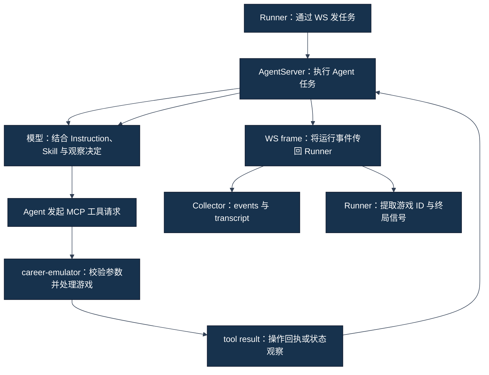

# 07｜从模型决定到 Tool 调用再到新状态

[学习地图](00-学习地图.md) · [上一章](06-Runner如何启动并驱动一局CareerSim.md) · [下一章](08-日志、Session、Score与证据是怎么产生的.md)

## 1. 一次决定经过哪些边界

LLM（大语言模型）生成内容，Tool call（工具调用）请求外部操作，MCP（模型上下文协议）把工具接口接到 career-emulator（游戏环境）。三者协作，但不是同一个执行者。



图中两种循环不同：Agent 与游戏之间进行决策/工具交互；Runner 从服务接收可观察帧并维持长任务。图是系统职责解释，具体 JiuwenSwarm 内部每一层回调、调度和模型请求拼装细节不在本轮来源范围，未恢复部分为 `UNKNOWN`。

**FACT｜事实**：[ws_client.py](../../../career_sim_runner/ws_client.py) 发送的是模型任务，解析的是服务返回帧；[transcript.py](../../../career_sim_runner/transcript.py) 把帧内工具事件落盘。Skill 对模型应怎样决定的要求，见 [Track A](../track-a-skill/00-学习地图.md)；本章不重写这些策略规则。

## 2. 六种对象的区别

| 对象 | 含义 | 能证明什么 | 主要限制 |
|---|---|---|---|
| Model text（模型文本） | 模型说出的解释、计划、结论 | 可观察到模型这样表述 | 不证明环境真的执行 |
| Tool call（工具调用） | 工具名、参数、请求关联信息 | 发起了外部操作请求 | 未必成功；请求内容可能非法 |
| Tool result（工具结果） | 由工具接口返回的回执/数据 | 该工具对请求的响应 | 回执可能只有成功标记，并不含完整状态 |
| External state（外部状态） | 游戏当前持久化/可观察状态 | 正确归属的最新观察可支持状态结论 | 需要游戏 ID 和时间顺序，不能拿另一局替代 |
| Transcript（文本记录） | Collector 整理的可读文本 | 便于追踪模型可见叙述 | 会丢失结构、类型和部分关联信息 |
| Structured event（结构化事件） | JSONL 中的事件类型、序号、时间与 payload | 便于定位工具、usage、完成帧 | 仍是采集视角；不自动等同全部后台事实 |

Frame（消息帧）是一次 WS 接收单位。一个帧可能嵌套多个事件；一个事件也不能简单当成一次独立游戏动作。Frame count、模型轮次、工具调用数与游戏月份是不同计数。

## 3. “我选择 B”还缺哪些证据

**TEACHING EXAMPLE｜教学示例，不是历史 Run 原始记录。** 模型写：“我选择 B，以保留健康。”

这时只出现了模型文本。随后还必须有针对正确游戏与当前事件的合法 `take_action` 请求；工具回执要成功；需要新状态时还要取得该游戏后续的 `observe`。不能从这句话反推出参数、行动成功、健康变化或月份推进。

这里不展示一份猜测的完整 `take_action` schema（参数合同）。真实参数须以当时工具合同和当前事件为准，不能把 Skill 里的自然语言选项名称当作可提交枚举。历史 exact-v6 已有 Energy choice 6、7、3 被拒绝的案例，见[第 09 章](09-为什么我们做了那么多工程验证与排障.md)。

### 读取 Collector 事件时要保留外层与内层

**TEACHING EXAMPLE｜教学示例，不是历史 Run 原始记录。** 下列是简化的事件记录形状，不是完整服务协议或可执行 MCP 请求：

```json
{
  "seq": 12,
  "kind": "tool_result",
  "payload": {
    "event_type": "chat.tool_result",
    "tool_name": "mcp_career-emulator_observe",
    "raw_output": {"result": {"current_state": {"session_id": "example-game"}}}
  }
}
```

Collector 外层 `kind` 是便于审计的分类；`payload` 保留原事件节点；其中 `raw_output.result` 在真实源码中可以是 JSON 字符串或字典。图示省略 `ts` 等字段，不能直接拿这份教学片段做完整历史数据解析模板。Runner 提取信号时检查内层 `event_type` 与工具前缀，而不是寻找所有字符串里的“observe”。

## 4. take_action receipt 与 fresh observe

Receipt（操作回执）回答“工具怎样处理这个请求”。Fresh observe（行动后新鲜观察）回答“这次操作后目标游戏当前是什么状态”。

**FACT｜事实**：[RUN_HISTORY](../../project/RUN_HISTORY.md) 的 v7t / S08-RUN03 有 207 次行动、190 次观察，18 个行动回执缺少 `outcome`，且未得到可替代新观察的公开状态等价回执。这些回执只含成功/错误性质信息。`success=true` 不能自动提供下一事件、健康、月份、资源等完整观察。

**INTERPRETATION｜解释**：如果方案的状态板需要更新，应该依据正确游戏的返回状态和新观察。模型先前的计划、成功回执和事后猜测都不具备相同证据强度。具体“一行动一闭环”的策略要求在 [Track A 第 06 章](../track-a-skill/06-三Skill协同与一次Action闭环.md)。

Fresh 是时间关系，不是文件名。一个 `observe` 即使结构正确，若发生在行动之前、属于别的 session，或无法关联到该行动，就不能称为该行动的后置新观察。审计还要核对行动失败、重复回执和末尾终局等边界。

## 5. Collector 怎样从帧生成证据

### 核心函数：StreamCollector.feed_frame()

| 问题 | 源码回答 |
|---|---|
| 输入 | 一份服务返回的 frame 字典 |
| 主要步骤 | 递归寻找 usage、工具调用/结果节点；整理文本缓冲；在最终帧处记录完成状态 |
| 输出 | 追加 JSONL 事件、文本日志，更新 token 汇总，并可触发展示回调 |
| 为什么存在 | 将实时消息转成能回看、定位和离线分析的材料 |
| 不负责什么 | 执行工具、改变游戏、替游戏结算、自动验证 Skill 遵循 |

`_append_event()` 增加序号并写 UTC 时间戳；`_flush_text()` 写出文本缓冲；`feed_frame()` 在工具节点、文本换行或最终帧处强制刷新；`finalize()` 刷出余下文本。Stream（流式输出）的块边界是传输/整理边界，不是句子真实性的保证。

源码注释描述文本提取会跳过 reasoning 节点；本轮只确认源码的提取逻辑，不能扩张为“所有内部推理、敏感信息都绝不会进入日志”。归档仍需项目规定的范围选择和 secret scan（敏感信息扫描）。

## 6. 看到工具事件，还不能直接做哪几种统计

- 多层 JSON 不能重复统计同一个嵌套节点；关联 ID 的去重规则须写清。
- `tool_call` 不是成功行动；要检查对应结果及 `success`。
- 最后一段模型文字不是官方评分；要检查 DB/终局来源。
- 能找到 Skill 名称，不等于正文被读入；要分别证明发现、加载和应用。
- 标记字符串的出现次数，不等于逐行动遵循；需逐项关联证据。

**FACT｜事实**：S08-09 取证发现旧审计把大量带换行的合法候选内容标成 parser false negative（解析器误判为缺失/不合法）；同时确实存在不合法的 checkpoint 枚举。审计工具也会出错，不能拿它的汇总标签替代原始调用/回执。案例与来源见[第 09 章](09-为什么我们做了那么多工程验证与排障.md)。

## 7. 一个读者自检

**TEACHING EXAMPLE｜教学示例，不是历史 Run 原始记录。** 你有一份写着“已成功晋升”的 transcript，却没有对应工具结果，也不知道 game session。合适结论是“模型文本声称晋升，环境结果未被证实”。下一步应寻找已获准保留的正确事件和观察，不能为了补这份历史证据另开一局。

下一章解释为什么这些证据还需要共同绑定 Candidate、drive、game 与输出目录。
